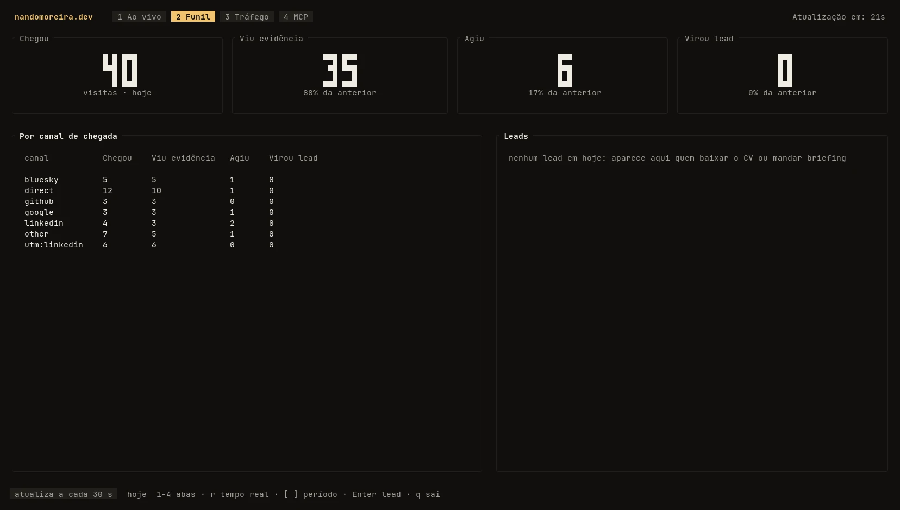
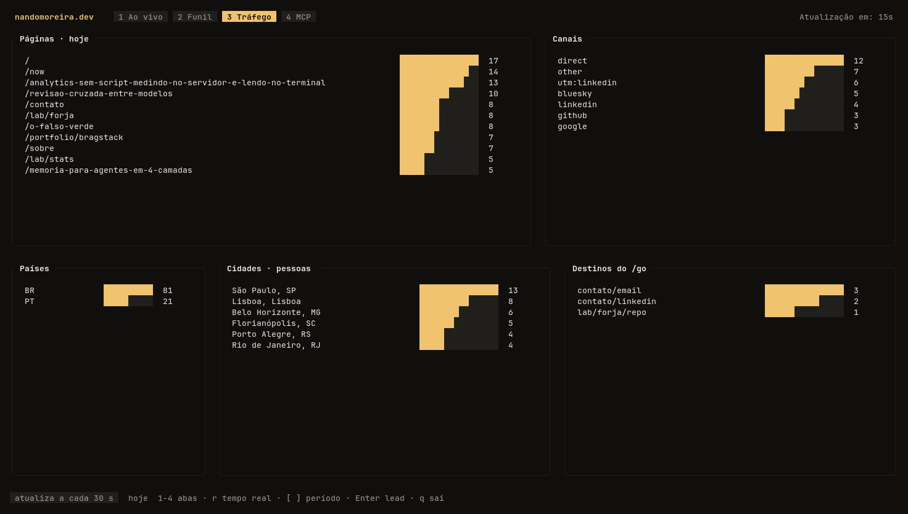
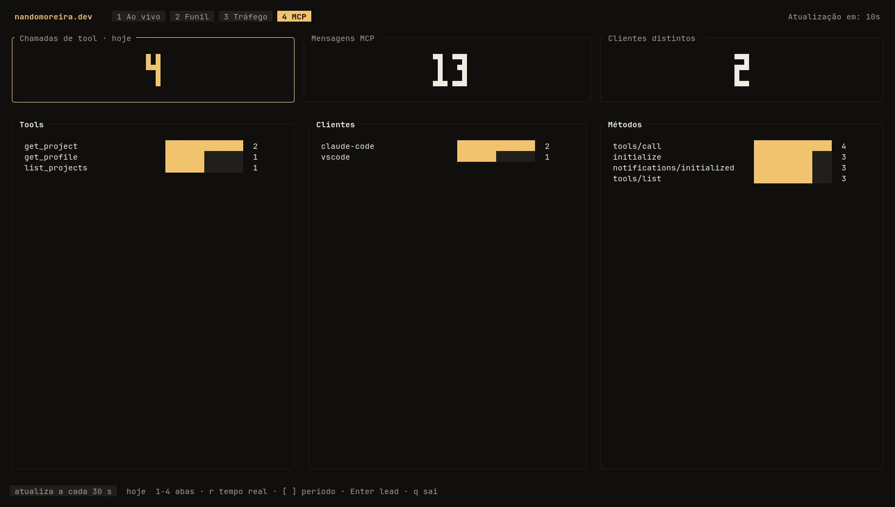
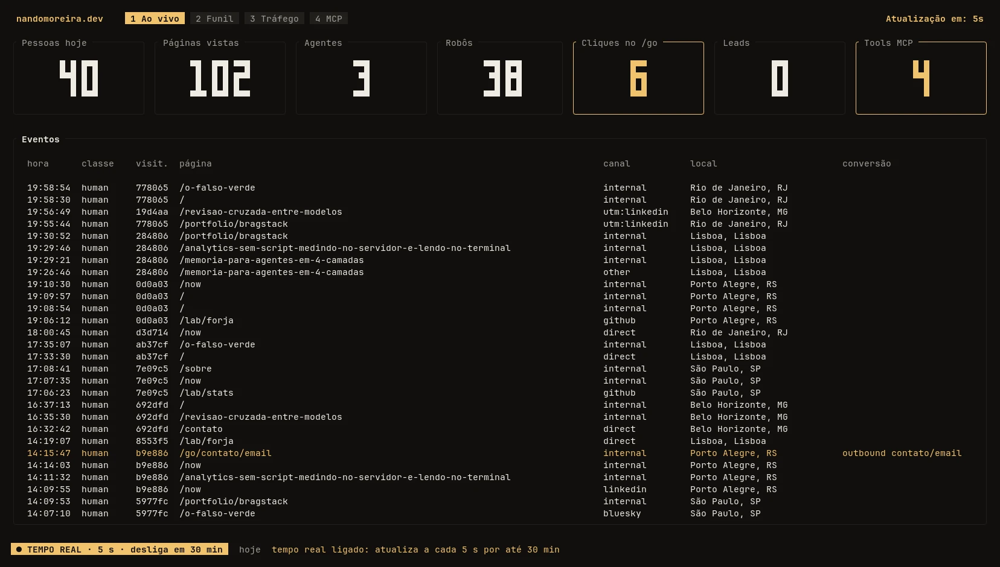

I opened `stats` in the terminal, hit `r` to refresh every 5 seconds and browsed the site on my phone. `/en/now`, `/en/about`, `/en/contact`, `/en/mcp`: each page showed up on the panel a few seconds later. It was exactly what I wanted to see working, and exactly what should not have appeared, because that phone was marked not to be counted.

That was the last bug of a full day turning a homemade analytics into something real. This is not a tool comparison or a tutorial on how to build yours. It is what I chose to measure, how it measured, what broke along the way and the panel I use to read all of it.

## The basics, with no browser script

Analytics tools do a lot for a small site. I only wanted the basics: how many people arrive, where they came from, what they read and whether anyone became a contact. And I did not want scripts injected into my site without need.

The site already had a written rule about that. Browser JavaScript only enters by a named exception (today those are the pointer effect, the Copy button and the `/en/now` audio preview), and a test fails the build if any other script shows up. An analytics snippet would be one more exception, and a big one.

The alternatives did not add up either. A self-hosted Plausible or Umami means more infra and more database to keep for a site that pays for none of that. Google Analytics solves it for free, but then the data of whoever visits the site, including whoever later becomes a client, ends up with a third party, third-party cookie included. **If visitor data is going to be stored, let it stay in my database, under the rule I wrote.**

What entered the measurement, then: the page, the arrival channel (the domain the person came from, or the link's `utm_source`), the country, whether who arrived is a person, an AI agent or a bot, and the conversions. Conversion here is a briefing sent through `/api/hire`, a résumé download, a call to the site's [MCP](https://modelcontextprotocol.io) and a click on my contacts or on the project links.

## Count on the server, and a pixel where the server cannot see

Most of the site is rendered on every request, so the count lives in the [Astro](https://astro.build) middleware: the response goes out, and before that the server records the visit. Posts and cases are another story. They are prerendered at build time and the Node server delivers them as a static file **before** the middleware runs. For them the count would be zero.

The way out was the oldest trick on the web: a 1×1 pixel image, served by the same domain, at the end of every prerendered page.

```html

```

`/v.gif` reads the `Referer` to know which page loaded it, checks whether that page exists in the sitemap (a pixel called from outside records nothing) and always answers with the same transparent GIF, with `no-store`. It is an image, not a script, so the JavaScript gate stays the same.

Outbound clicks go through `/go/`. The "Source code" link of a case points to `/go/lab/<slug>/repo`, which records the click and redirects. The destination comes from a table built from the profile and the projects, never from the URL, so `/go` does not become an open redirect for anyone who wants to use the domain as a trampoline.

One platform detail decided how the write happens. The site runs on Firebase App Hosting, on top of Cloud Run, which cuts CPU when the response finishes. Writing "in the background" and returning the page right away looks polite, but the write simply does not happen. The write is awaited, with a 250 ms ceiling, and any failure is swallowed: measuring never takes a page down.

## Tie the pages without a cookie

To know that three pages were seen by the same person without giving anyone a cookie, the server computes a code from the IP and the browser, mixed with a secret key that changes every day. The IP is not stored, and today's code does not link to tomorrow's. The trade-off is accepted: the per-person funnel only exists inside a day, and whoever switches networks in the middle of the afternoon becomes two visits.

The data lives in Firestore, which the site already used to store briefings, so there was no new database and no new account to pay for. Each visit stays 30 days and is deleted on its own by TTL; after that only daily totals remain, with no visitor code at all, for 24 months. Country and city come from Cloudflare, in the `cf-ipcountry` and `cf-ipcity` headers, and the city stays only on each visit record, never in the totals.

When someone sends a briefing or downloads the résumé, the email I get carries the pages that person saw that day. And the privacy policy was rewritten to say that in plain words, including the part fewer people like to admit: while you only browse, nothing says who you are, but if you fill in the form, the pages of your day go along with your name.

## Read it in the terminal

To read all of this I did not want another web panel. `stats` is a Rust TUI, with [ratatui](https://ratatui.rs), that lives in the same site repository under `tools/stats/`. That way, when the data format changes on the site, the reader changes in the same commit.

It reads Firestore through the REST API with the `gcloud` credential I already use in the terminal. If there is no login, it runs `gcloud auth application-default login` itself, the browser opens and the TUI continues. There are four tabs:

| Tab | What it shows |
|---|---|
| Live | Today's totals in large numbers and the event feed, with conversions in amber |
| Funnel | Arrived, saw a case or post, clicked a link, became a lead; overall and by arrival channel |
| Traffic | Most clicked pages, channels, countries, cities and `/go` destinations |
| MCP | Calls by tool, by client and by method |

The screenshots below are from `stats --demo`, which generates 30 days of invented visits without touching Firestore. The numbers are fake; the screens are the real ones.







Refresh is every 30 seconds. Firestore charges at least one read per query, even an empty one, so the 5-second mode (the `r` key) turns itself off after 30 minutes. It is for watching the moment right after publishing a post, and it is easy to leave it on.



## What broke

The first stumble came before the code reached production. To check the deploy, I ran a `curl` against `/v.gif` when the route did not exist yet. The answer was a 404 with `cache-control: max-age=1800`, and Cloudflare, which treats `.gif` as a static file, kept that 404 at the edge for half an hour. After the deploy the route answered fine at the origin, but whoever asked through the normal URL got the cached 404. It was fixed by purging only that URL in the Cloudflare panel.

The second was the phone from the opening. So I do not count my own visits, the site has a `/eu` route that, with the right token, sets a cookie in the browser, and the server ignores whoever arrives with it. I marked the phone, the iPad and the laptop. I opened `stats`, turned on the 5 seconds and all my pages showed up. `Set-Cookie` reached the browser fine. What did not come back was the cookie: a request with `Cookie: nm_self=1` was recorded as a normal visit. Firebase Hosting is known for forwarding to the server only the cookie named `__session` and dropping the rest on the way, and App Hosting behaved the same way. The cookie became `__session=self`, I marked the three devices again and my visits left the count.

The third was a label. The "People today" card showed the page-view counter for people, so every page I opened added one. Now it counts distinct visitors for the day, and page views got a card of their own.

And there was what the code review caught before going live. What would have changed the numbers most was MCP: every protocol message counted as a conversion, so a single real use (`initialize`, `notifications/initialized`, `tools/list` and the tool call) added four. Only the tool call counts now.

## Starting from zero

At the end of the day I deleted every measurement record, including my tests, and the panel started empty. There is no number in this text because there is still no number worth keeping: the idea is to watch each post I share on social media and see in `stats` what actually brings a reader and what brings a contact.

`ratatui::restore();`
