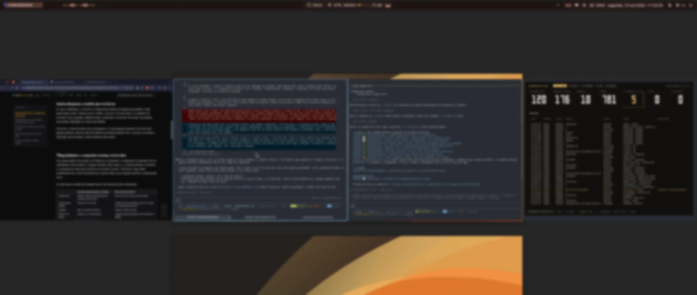
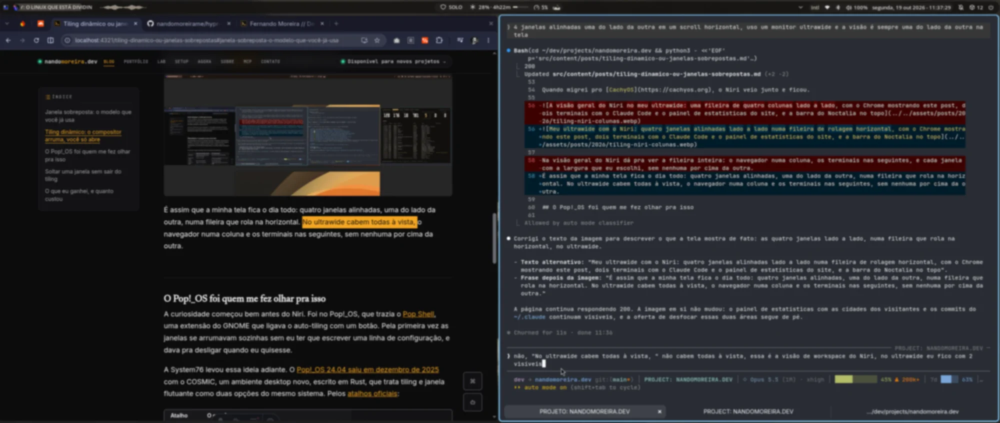

It took me a few months to stop pressing `Alt+Tab`. It was a years-long habit from Windows and macOS: my hand went to the shortcut on its own, I kept cycling window after window looking for the terminal, and only then remembered that in [Niri](https://github.com/YaLTeR/niri) the terminal was two columns to the left, one shortcut away.

The habit was so strong that, when I still used [Hyprland](https://hypr.land), I tried to bring `Alt+Tab` along instead of quitting it: I wrote [hypr-switcher](https://github.com/nandomoreirame/hypr-switcher), a visual Alt+Tab in Rust that shows every open window, from every workspace, in a panel over the screen. It worked, but I was adapting tiling to the old habit, when the right move was to drop the habit.

## Stacked windows: the model you already use

It is what Windows, macOS and most distros ship by default. Each window opens where the system thinks best, one on top of another, and arranging them is your job: drag, resize, maximize, minimize. To find a hidden window, `Alt+Tab` or the taskbar.

It works, and it works well for a lot of people. The cost shows up when you have ten windows open: part of the day goes away arranging windows with the mouse and cycling `Alt+Tab` after whatever disappeared under the others.

## Dynamic tiling: the compositor arranges, you just open

In a tiling window manager (or compositor, on Wayland), windows do not overlap. They split the screen space, side by side, and the system decides the size and position of each one as you open and close. "Dynamic" means exactly that: you do not draw the layout beforehand, it adjusts itself with every new window.

The two I really tested do this in very different ways:

| | Hyprland (default layout, dwindle) | Niri (scrollable columns) |
|---|---|---|
| New window | splits the focused window's space in half, in a tree | comes in as a new column beside it |
| Screen full of windows | each one gets smaller | the row grows to the right, endlessly, and the screen becomes a window over it |
| Navigate | by focus between the blocks | by scrolling the row sideways |
| Float a window | `Super+V` in the default config | `toggle-window-floating`, which I bound to `Mod+V` |

Hyprland ships by default on [Omarchy](https://omarchy.org), DHH's distro that I used for a few months. Its layout, [dwindle](https://wiki.hypr.land/0.24.0/Configuring/Dwindle-Layout), treats the screen as a binary tree: each new window splits the focused window in two, and the cut direction depends on the proportion of the remaining space.

Still on Omarchy, I installed Niri to compare. What won me over was the infinite horizontal row (man, that enchanted me): each window opens as a column, the screen shows a slice of the row and you scroll sideways. Nothing gets squeezed because another window opened; it just joins the queue. On my 34" ultrawide, with the default column at half the screen and `Mod+R` cycling between one third, half and two thirds, that is all I need:

```kdl
layout {
    preset-column-widths {
        proportion 0.33333
        proportion 0.5
        proportion 0.66667
    }

    default-column-width { proportion 0.5; }
}
```

When I moved to [CachyOS](https://cachyos.org), Niri came along and stayed.



In Niri's workspace overview you can see the whole row: four windows lined up, one beside the other, with none on top of another. Day to day the ultrawide shows two at a time, and I scroll the row sideways to reach the others.



## Pop!_OS is what made me look at this

The curiosity started well before Niri. It was on Pop!_OS, which shipped [Pop Shell](https://github.com/pop-os/shell), a GNOME extension that turned on auto-tiling with a button. For the first time the windows arranged themselves without me writing a line of config, and I could turn it off when I wanted.

System76 took that idea further. [Pop!_OS 24.04 came out in December 2025](https://www.gamingonlinux.com/2025/12/pop-os-24-04-lts-with-the-cosmic-desktop-environment-is-out-now/page=1/) with COSMIC, a new desktop environment, written in Rust, that treats tiling and floating windows as two options of the same system. From the [official shortcuts](https://system76.com/support/articles/pop-cosmic-keyboard-shortcuts):

| Shortcut | What it does |
|---|---|
| `Super+Y` | turns tiling on and off on the current workspace |
| `Super+G` | floats or docks a window |
| `Super+S` | stacks windows in tabs |
| `Super+O` | switches the cut orientation, from vertical to horizontal |

Tiling also turns on from a panel applet, and a floating window dragged to the edge of the screen snaps into half or a quarter of it, like on Windows. So someone coming from Windows does not need to pick a side on day one: start with loose windows and turn tiling on in one workspace only, to see if you like it.

I have not tried COSMIC yet. I have heard a lot of good things about it and I am curious, but everything in this section comes from the docs, not from my machine.

## Floating a window without leaving tiling

The most common objection from people who have never used tiling is "but what about when I want a loose window, in the middle of the screen?". All three allow it. On Hyprland it is `Super+V`, on COSMIC it is `Super+G`, and on Niri it is `toggle-window-floating`, plus `switch-focus-between-floating-and-tiling` to jump focus between the floating windows and the columns.

In practice I almost never use the shortcut. I use floating windows a lot, but for temporary-use apps: they open in the middle of the screen, I quickly do what I need and hide them again. Instead of floating by hand every time, I leave a rule in `config.kdl` that already opens those apps floating:

```kdl
window-rule {
    match app-id=r#"(?i)zapzap"#
    open-floating true
}
```

WhatsApp, Spotify, Discord, Obsidian and YouTube Music open that way, and a shortcut makes each one appear and disappear without taking a column. Since Niri has no minimize, I built that with a hidden workspace, and I told how [in the scratchpad post](/en/niri-scratchpad-windows-vanish).

## What I gained, and what it cost

The cost was `Alt+Tab`. The first months were my hand going for the wrong shortcut, and relearning to navigate by position (the window is to the left, the window is on workspace 2) instead of by list.

The gain is control. Everything that is open is mapped in my head: I know the browser is in one column, the terminals in the next ones, and with two or three shortcuts I reach any window without searching. Nothing stays hidden under another window, because there is no "under".

## Conclusion

The question everyone asks is whether tiling is better than stacked windows. For me that is the wrong question. Today I am not going back, but **tiling is not better than stacked windows: it is another way to organize, and you decide by trying**. If you have used Linux for a while, your environment came with one of these models without anyone asking you anything, and it is worth finding out which one fits your head.

Some people think better with loose windows and the mouse in hand, and that is fine. Try both models for a few weeks each, and not for one afternoon: my first months of tiling were bad because I was fighting the habit, not the tool. COSMIC looks like the easiest way to run that test, since you turn tiling on and off per workspace without installing anything. Then use whichever you like more.

`niri msg action quit`
