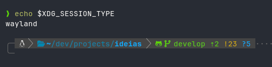
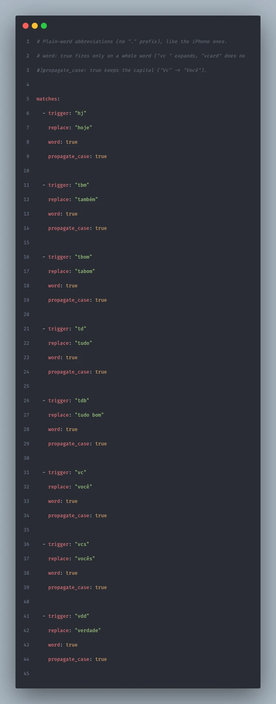

On the iPhone I type `vc` and get "você", I type `.email` and get my full email. I used macOS for a few years with the same "Text Replacement" configured, and the list grew with it: address, CNPJ, WhatsApp link, `(╯°□°)╯︵ ┻━┻` for the rough days. On [CachyOS](https://cachyos.org), that did not exist, and I missed it.

My first idea was to write a tool for it. No need: [espanso](https://github.com/espanso/espanso) has existed since 2019, is written in Rust, runs on Linux, macOS and Windows, and had a fresh release (2.4.1) when I installed it. What the docs do not make clear is what changes when your desktop is Wayland, with a compositor that is neither GNOME nor KDE. Here it is CachyOS with [Niri](https://github.com/YaLTeR/niri), and it took three tweaks to get it right.

## What espanso does

It listens to the keyboard and, when you finish typing a trigger, deletes the trigger and puts the text in its place. It works in any text field: browser, terminal, chat, editor. The shortcuts live in YAML files under `~/.config/espanso/match/`, and it reloads on its own when you save.

```yaml
matches:
  - trigger: ".email"
    replace: "voce@exemplo.com"
```

Besides fixed text, it accepts variables (date, time, command output, clipboard), forms and regex. Beyond dates, I barely use that; the fun for me is the short shortcut list that already lives in my muscle memory.

## Installing on each distro

First find out whether your session is X11 or Wayland, because espanso has a build for each:

```bash
echo $XDG_SESSION_TYPE
```



On Wayland it reads the keyboard straight from the kernel (evdev), so the binary needs an extra capability. That `setcap` shows up in every Wayland install below, and forgetting it gives the worst symptom possible: espanso runs, but sees no keys.

### Arch, CachyOS and Manjaro

It comes from the AUR, which compiles Rust, so it takes a few minutes:

```bash
paru -S espanso-wayland   # ou espanso-x11
espanso service register
espanso start
```

The AUR package already applies `setcap` on install.

### Ubuntu and Debian

For Wayland:

```bash
wget https://github.com/espanso/espanso/releases/latest/download/espanso-debian-wayland-amd64.deb
sudo apt install ./espanso-debian-wayland-amd64.deb
sudo setcap "cap_dac_override+p" $(which espanso)
espanso service register
espanso start
```

For X11, swap the `.deb` for `espanso-debian-x11-amd64.deb` and skip `setcap`.

### Fedora

After enabling the [Terra repository](https://developer.fyralabs.com/terra/installing):

```bash
sudo dnf install espanso-wayland   # ou espanso-x11
sudo setcap "cap_dac_override+p" $(which espanso)
espanso service register
espanso start
```

### Other distros

With X11 there is an AppImage that runs on any distro, and you can build from source in both cases. The commands are on the [Linux install page](https://espanso.org/docs/install/linux/).

## The first start that said it had worked

I installed it, ran `espanso service register` and `espanso start`. The output was this:

```text
unable to start service: timed out
```

And the exit code was 0. My setup script read the 0, printed a green check and moved on with espanso stopped (the kind of green I have already learned to distrust). `espanso status` told the truth: `espanso is not running`.

The cause was in a window. On the first run, the launcher opens a welcome screen and only starts the daemon after someone clicks it; the timeout was it waiting for my click. I went to the source and, on Linux, that screen is the only page of the wizard. It is skipped when a file with a preference written as JSON exists:

```bash
mkdir -p ~/.cache/espanso/kvs
printf 'true' > ~/.cache/espanso/kvs/has_completed_wizard
```

Clicking the window fixes it the same way. The file is for when the install runs on its own, on a fresh OS, with nobody watching. And the rule that stuck: after `start`, what says whether it came up is `espanso status`, not the exit code.

## Three tweaks in default.yml

This is my `config/default.yml`, with why each line is there:

```yaml title="config/default.yml"
keyboard_layout:
  layout: "us,br"
  variant: "intl,"

backend: Clipboard
preserve_clipboard: true

search_shortcut: off
```

The layout has to be declared. Outside GNOME and KDE, espanso cannot discover the active layout on Wayland (the log warns with `keyboard layout watcher couldn't determine active layout`). I copied the `xkb` block from my Niri `config.kdl`, which uses international `us` with `br` as a second option. If you use plain ABNT2, it is `layout: "br"`.

Text goes in through the clipboard. Espanso's default is to simulate keys, and **on `us-intl` that is a trap**: single and double quotes are dead keys. An injected `'` followed by `c` becomes `ç`, and the text arrives broken. With `backend: Clipboard`, it pastes the text and restores what was on the clipboard before.

The search shortcut is gone. Espanso opens a shortcut search with Alt+Space, which on my Niri is the key that switches between the `us` and `br` layouts. I turned search off.

## Why my shortcuts start with a dot

The docs convention is to start the trigger with a colon: `:email`. That did not last: in several apps (Slack, Discord, GitHub) `:` followed by letters opens the emoji picker, and the picker showed up before espanso swapped the text.

I went back to the dot, which is how I already did it on the iPhone. The dot has the opposite problem: it shows up in the middle of a domain, a filename and a version. Without care, `nandomoreira.site` would become `nandomoreirahttps://...`. The `left_word` option fixes that, because the trigger only fires at the start of a word:

```yaml
  - trigger: ".site"
    left_word: true
    replace: "https://seusite.dev"
```

Shortcuts without a dot, like `vc` and `tbm`, need the whole word (`word: true`), otherwise `vcard` would become `vocêard`. And `propagate_case` keeps the capital: `Vc` becomes "Você".

```yaml
  - trigger: "vc"
    replace: "você"
    word: true
    propagate_case: true
```



One thing I found by testing, and I tell it because it will happen to anyone coming from the iPhone. There the swap happens when you type the space after the shortcut. I tried `@@` after a word and got `contato @nandomoreira.dev`, with a leftover space. The space was mine: I was typing as if it were what triggered the swap. In espanso, a dotted shortcut expands the moment you finish typing it, with no space wait. Only the whole-word ones (`word: true`) wait for a separator, and that separator stays in the text.

## How I organized the 41 shortcuts

I screenshotted the list in iPhone Settings, moved everything to YAML and split it into four files under `match/`:

| File | What is in it |
|---|---|
| `base.yml` | Contact and links (email, site, GitHub, WhatsApp) and dates |
| `personal.yml` | Documents and address |
| `abbrev.yml` | Abbreviations without a dot: `vc`, `vcs`, `tbm`, `hj`, `td`, `vdd` |
| `fun.yml` | Laughs, `(╯°□°)╯︵ ┻━┻`, `¯\_(ツ)_/¯` and the inside jokes |

Personal data lives in a separate file on purpose: if that folder ever ends up in a public repository, I know exactly what to pull out.

Two features that paid off. A shortcut can have more than one trigger, which cleaned up the duplicates I carried from the iPhone (`.wa` and `.whats` pointed at the same link):

```yaml
  - triggers: [".wa", ".whats"]
    left_word: true
    replace: "https://wa.me/5511900000000"
```

And dates, which the iPhone does not do, come out in Brazilian format:

```yaml
  - trigger: ".hoje"
    left_word: true
    replace: "{{today}}"
    vars:
      - name: today
        type: date
        params:
          format: "%d/%m/%Y"
```

When a shortcut does not work after saving, it is almost always YAML indentation. Two commands show where:

```bash
espanso match list                     # o que ele carregou de fato
grep ERROR ~/.cache/espanso/espanso.log
```

## On a fresh OS, without remembering anything

The `~/.config/espanso` folder here is a symlink into my dotfiles, so the shortcuts travel with the rest of the config. On a fresh OS, the setup installs `espanso-wayland`, checks the capability, marks the welcome screen as seen, registers the service and only goes green when `espanso status` confirms. Each step only runs if its check fails, and a `--check` repeats the checks without changing anything.

I stuck with espanso and wrote no tool of my own. And, to be honest, I like how it solves this problem a lot more than iPhone and macOS Text Replacement. There it is a list of shortcut and text, and that is it. Here I get a date in whatever format I want, more than one trigger for the same text, control over when the shortcut fires (start of word, whole word, capital kept) and everything in a file I version with the rest of my config. **I decide what is written and how it is written.**

The three tweaks above are now in the script, and a fresh OS is born with my shortcuts.

`{{end}}`
