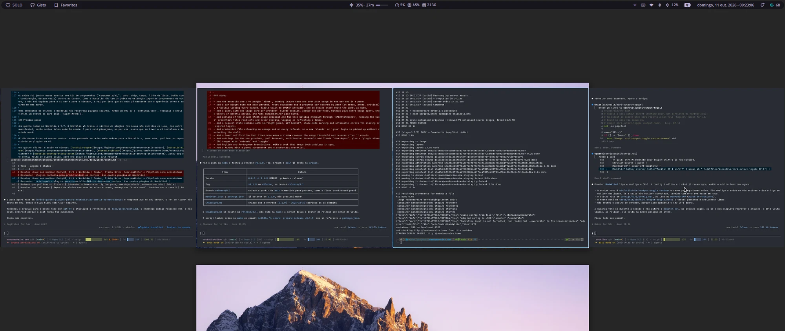

I use the keyboard a lot. My Niri `config.kdl` has more than 140 lines of shortcuts: I open the apps I use most straight from a key, and anything without its own shortcut goes through the [Noctalia](https://github.com/noctalia-dev/noctalia-shell) launcher (`Ctrl+Space`). [Obsidian](https://obsidian.md), WhatsApp and YouTube Music live in scratchpads, windows that show and hide with a shortcut without taking a column. The bar is the other half: it stays in view, so what I checked several times a day belonged there, one shortcut or one click away.

What still pulled me out of what I was doing was the rest. Writing down a task or booking a meeting meant opening a different app for each thing, checking how much of the Claude Code plan was gone meant opening a page, and finding an old code snippet meant going to GitHub to hunt the right gist.

CachyOS was installed on this laptop on June 1, 2026. Eight days later I was already writing the first plugin for Noctalia, the bar that came with Niri. Today there are four, and I use all of them every day.

This is not a QML tutorial. It is the story of how I got here, how I use these tools and how they were built, with AI from start to finish.

## Before CachyOS, many distros

I have used a lot of operating systems. Windows XP, Vista and Seven between 2010 and 2014, Ubuntu around 2015, and macOS from 2016 to 2024. After the Mac I went back to Linux and passed through the Ubuntu-based distros: Linux Mint, Pop!_OS, ZorinOS and Ubuntu itself, which I used for years until I moved to ZorinOS in 2025. I also tried [Omarchy](https://omarchy.org) for a few months, until I found [CachyOS](https://cachyos.org).

What stuck was the mix of CachyOS with [Niri](https://github.com/YaLTeR/niri), a Wayland compositor that lays windows out in scrollable columns, and [Noctalia](https://github.com/noctalia-dev/noctalia), which plays the whole shell: bar, launcher, notifications, lock screen. And Noctalia has a plugin system.

**That is where the idea came from: put on the bar what made me leave what I was doing.** I looked around the community and found almost no plugin for any of this. The exception was [Model Usage](https://github.com/noctalia-dev/noctalia-plugins), which I used for a few months until I built my own.



## The four plugins

### Desktop Sticky Notes

The first one, started on June 9. Sticky notes pinned to the desktop as widgets: each with a post-it color, Markdown text and its own size. A click opens an editor, and a note can stay tied to a `.md` file on disk, updating when the file changes. The Markdown renderer and the editor layout came from sapjax's sticky-notes plugin, also MIT, with credit in the repo.


[See Desktop Sticky Notes in the lab](/en/lab/noctalia-desktop-sticky-notes)

### Daybar

`Mod+Space` opens a capture field in the center of the screen that understands free text: "buy bread tomorrow 9am" becomes a task, "/e meeting Friday 3pm-4pm" becomes an event on Google Calendar, a URL becomes a favorite with a page preview, "=200\*15%" becomes a calculation with the result copied. `Mod+Shift+Space` opens the panel with the calendar, the day's checklist, the pomodoro, favorites and notes.

Google Calendar is read and written by `khal` and synced by `vdirsyncer`, with credentials in the system keyring, not in a file.


In v0.3.0, from October 12, Daybar got a timer. I wanted something simple: type how long I want, watch the countdown and get the alarm at the end. It became a fourth Focus tab, next to Focus, Short break and Long break, and it also starts from capture: `/t 10m tea` starts counting, and `/p` starts or pauses the pomodoro. Only one clock runs at a time (starting the timer pauses the pomodoro, and the other way around too, without losing the time left), and the last four timers stay there as one-click shortcuts.


The clock also leaves the panel. One click opens the countdown in a Niri window that I move and resize, and another pins a small clock to a screen corner, above the windows and on every workspace. Both come back open when the shell restarts.


[See Daybar in the lab](/en/lab/noctalia-daybar)

### AI Bar

Built on October 10, to replace Model Usage. It shows on the bar how much of the Claude Code and Grok plans has already been used: the percentage of the most critical window, the time until it resets and a progress bar. In the panel, each window shows the usage pace, which compares the percentage spent with the percentage of time that has already passed. If I am ahead, I know before I hit the limit in the middle of work.

CLI credentials are read only, never written or renewed. The endpoints and gotchas came from [ai-usagebar](https://github.com/akitaonrails/ai-usagebar), by Fabio Akita (who tells how he built his [in this post](https://akitaonrails.com/2026/05/24/criei-widget-waybar-omarchy-monitorar-uso-llms-ai-usagebar/)), without reusing the code.


[See AI Bar in the lab](/en/lab/noctalia-aibar)

### Gistbar

Built the same day. I have 95 gists on GitHub, and finding a snippet meant opening the browser, remembering which gist it was in and copying by hand. Now `Mod+G` opens search, which looks at description, file name, language and content, and Enter copies the first file. `Mod+Ctrl+G` creates a gist from the clipboard, and it is born secret, because publishing by mistake is the worst thing this plugin could do.

Every GitHub access goes through `gh`, so the plugin never touches a token.


[See Gistbar in the lab](/en/lab/noctalia-gistbar)

## 100% AI, in the RPI flow

I did not write the code for these plugins by hand. They all came out of the same flow I use on any project: research and spec in Claude Code (`/rpi:research`), a plan with small tasks and the test before the code (`/rpi:plan`), and implementation in Grok (`/rpi:implement`), with Claude Code reviewing and committing. I told how it works in [RPI flow with three agents](/en/rpi-flow-with-three-agents).

It was fast. Daybar came out in a single day, morning to night, through three specs (the MVP, then favorites and notes, then deleting a calendar event). AI Bar was ready in about an hour and a half, and Gistbar in under an hour, both reusing the base Daybar left behind.

Daybar v0.3.0, the one with the timer and the floating clock, took one night and one morning. That round shipped without two of the three agents: Grok answered `402 Payment Required: Grok Build usage balance exhausted` on the first task, and Codex hit the usage limit. The flow accounts for that (each stage falls back to Claude Code when the tool does not answer), so it implemented and reviewed everything alone.

## What a plugin needs

A Noctalia plugin is a folder with a `manifest.json` and a few QML files. This is the whole Gistbar manifest:

```json title="manifest.json"
{
  "id": "gistbar",
  "name": "Gistbar",
  "version": "0.1.0",
  "minNoctaliaVersion": "4.6.0",
  "author": "Fernando Moreira Costa",
  "license": "MIT",
  "repository": "https://github.com/nandomoreirame/noctalia-gistbar",
  "description": "Search, copy, create and edit your GitHub gists from the bar, through the gh CLI.",
  "tags": ["Bar", "Panel", "Development", "Productivity"],
  "entryPoints": { "main": "Main.qml", "barWidget": "BarWidget.qml", "panel": "Panel.qml", "settings": "Settings.qml" },
  "dependencies": { "plugins": [] },
  "metadata": { "defaultSettings": { "listMinutes": 15 } }
}
```

The `entryPoints` say what the plugin has. The minimum to show up on the bar is `main` and `barWidget`: `Main.qml` holds state and runs commands (a Quickshell `Process` with a `Timer`), and `BarWidget.qml` is what you see. Panel and settings are optional. Sticky Notes swaps the bar for `desktopWidget`, because it lives on the desktop.

To install mine during development, a symlink is enough:

```bash
ln -s ~/dev/projects/noctalia-gistbar ~/.config/noctalia/plugins/gistbar
```

Then enable it in Settings > Plugins and put the widget on the bar.

In all four, the logic lives in pure JavaScript functions, tested with [Vitest](https://vitest.dev), and QML stays as the screen only. Daybar has 440 tests, Gistbar 151 and AI Bar 36. That is what lets the AI change the code without me checking every line.

Whether that is simple, I cannot say: I wrote everything with AI and have nothing to compare it to. What I do know is where the time went.

## The UI is what took the most work

The code worked. What came back every time was the bar panel UI: there was always some inconsistency I had to fix until it looked acceptable. Across the four plugins, there were 19 fixes just for visual polish and interface, 11 of them in Daybar.

The fixes were of this kind: pointer cursor on note and favorite rows, the empty-day message more faded and in italics, timer and controls centered, lists that do not jump while the delete confirmation is open and reachable by Tab. None of them is a logic bug. It is the kind of detail the AI does not see, because it does not look at the screen (I do).

The way out was to gather those fixes into a component kit (`components/ui/`: card, chip, field, list row, button with confirmation, empty state) inside Daybar. Since Noctalia has no way for one plugin to import components from another, the kit was copied into AI Bar and Gistbar, and that is why those two were born looking right and shipped in one afternoon.

With the timer it was the same. The Focus counter sat flat inside the circle, and in the large window the pause and restart buttons grew with it until they were huge. I sent the screenshot, the AI fixed it, and the next screenshot showed the next detail: the circle stroke too thick, the buttons pushing the numbers off center, the timer label that showed in the panel and not in the window.

One bug from that round was not about the screen. The first version of the window logged `Binding loop detected for property "progress"` when the shell came up. The window was born with the plugin's main service, and the circle calculation read the pomodoro config for the first time in the middle of its own binding, which rewrote the remaining time it was itself using. The fix was to create the display only when the window is visible, with a `Loader`.

One bonus gotcha: Noctalia does not reload plugins on its own. Change a QML file or `settings.json`, restart the shell (I made a shortcut just for that, `Super+Alt+B`).

## Next step

All four run on Noctalia 4.7.7. Noctalia v5 swapped the plugin system (the new ones are written in Luau, with a different manifest), so none of them runs there yet. The port is planned, one at a time, as soon as I have v5 installed and tested here.

And they should not stay at just these four: I am thinking of building more things for Noctalia and, who knows, publishing in the v5 plugin repository.

All four are MIT and live on GitHub: [noctalia-daybar](https://github.com/nandomoreirame/noctalia-daybar), [noctalia-aibar](https://github.com/nandomoreirame/noctalia-aibar), [noctalia-gistbar](https://github.com/nandomoreirame/noctalia-gistbar) and [noctalia-desktop-sticky-notes](https://github.com/nandomoreirame/noctalia-desktop-sticky-notes). Found a bug or missing something, open an issue or send a pull request.

`qs -c noctalia-shell kill`
