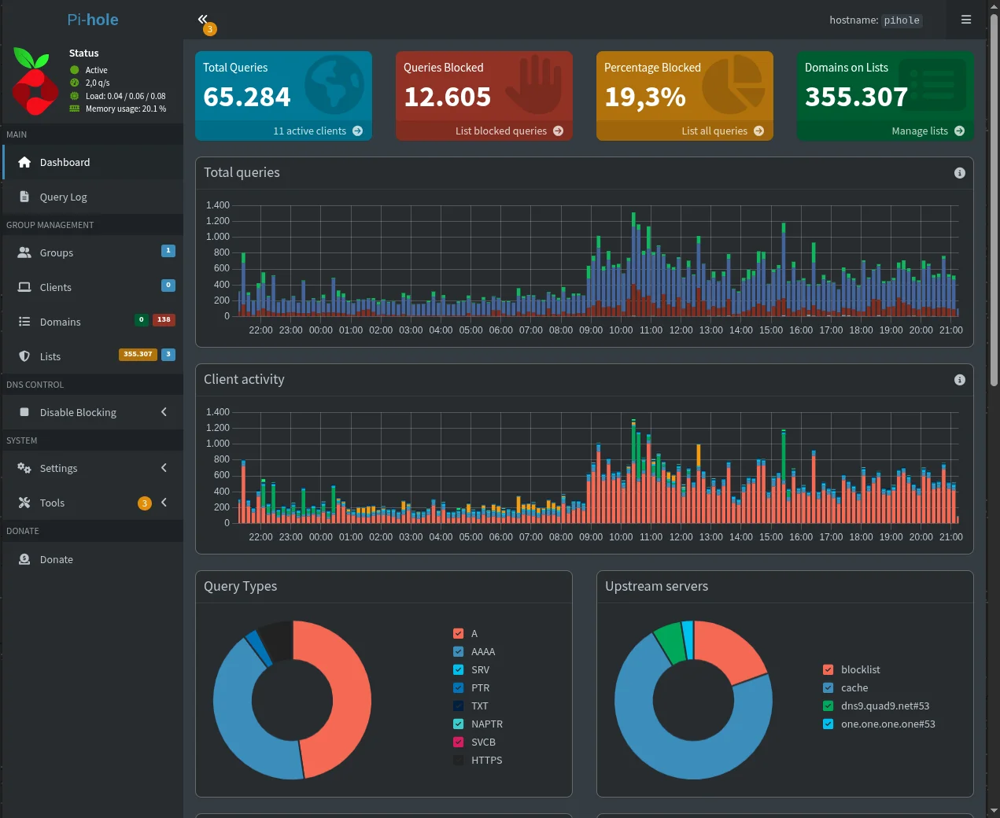

The [CasaOS](https://github.com/IceWhaleTech/CasaOS) dashboard (it installs and manages apps in Docker containers) says my homelab is at 6% CPU, 21% RAM and 5.5 W, at 49 °C. It is a 2018 Mac mini running Ubuntu 26.04, wired into the ISP modem, and that is where the house DNS, my music library, the laptop backups and this site's staging live.

The icon grid is the part everyone shows (and I do too, look at the cover). Only installing an app in CasaOS is one click, and the click is not what cost me time. What cost time was deciding which disk each thing lives on, how each device in the house finds the server and how I reach it when I am away.

I bought this Mac mini in October 2020 and it was my main computer for about two years. Then it became the secondary computer for a few more years, until it was legacy for good: macOS updates made everyday use impractical. That is when, in 2025, I decided to turn it into my personal homelab.

I have followed the Diolinux channel for many years (since 2012, roughly), so the idea of a home server had been floating around for a long time. If you have never heard of a homelab, his video [Como começar no Homelab do Zero? Guia para Iniciantes](https://www.youtube.com/watch?v=MUHk0PKn2TQ) explains what it is and where to start better than I would here.

## The SSD holds state, the HDD holds bulk

The Mac mini has a 232 GB internal SSD on btrfs. Everything that needs to be fast and stable lives there: the system, the containers and `/DATA/AppData`, where each app's configs and databases sit. The bulk (movies, music, photos, documents) goes to a 1 TB 5400 rpm HDD hanging off USB.

The apps never know. CasaOS expects everything under `/DATA`, so `/DATA/Media`, `/DATA/Gallery`, `/DATA/Documents`, `/DATA/Downloads` and `/DATA/Notas` are bind mounts to folders on the HDD, one `fstab` line each:

```
/mnt/HD-1TB/DATA/Media  /DATA/Media  none  bind,nofail,x-systemd.requires=/mnt/HD-1TB  0 0
```

**The two options at the end are what make this survive a reboot.** `x-systemd.requires` guarantees the HDD mounts before the bind, and `nofail` keeps a disconnected HDD from holding up the whole boot of a machine with no monitor.

I made that change in June, when the SSD hit 77%: `rsync -aHAX`, a file-count and size check, the old folder renamed to `.old` as a way back, the bind in place and only then the deletion. Freed about 48 GB. The other two disks on the cover are a 500 GB HDD from 2012, with bad sectors and near the end of its life, and the 64 GB USB stick with the arcade ROMs (I will get to that).

## The house arrives by cable, I arrive through Tailscale

The network is simple: the ISP modem in the middle, the homelab on a cable and the mesh routers in access-point mode, so everything lives on the same network.

To get into the server I use [Tailscale](https://tailscale.com) (a VPN that links my devices into a private network, the tailnet, from wherever I am), even inside the house. My `ssh homelab` points at the tailnet IP, not the local one, because my ssh-agent keys stopped authenticating on the local IP (every one gave `Permission denied (publickey)` until the agent blew up with "Too many authentication failures"). Tailscale SSH authenticates by the tailnet identity and the problem simply went away:

```
Host homelab
    HostName <IP do homelab na tailnet>
    User nandomoreira
```

Services get `.home` names, with [Caddy](https://caddyserver.com) in front doing the reverse proxy (it receives each address and forwards it to the right app):

```
http://media.home {
    reverse_proxy localhost:8096
}
```

[Pi-hole](https://pi-hole.net) resolves the `.home` names to the homelab's Tailscale IP, and Tailscale DNS sends `home` queries to it. The result is that `media.home` opens [Jellyfin](https://jellyfin.org) on the phone from anywhere, as long as the device is on my tailnet, and nowhere else.

Pi-hole is also the global nameserver for the tailnet, with local DNS overridden: every device of mine gets ad blocking even outside the house. The price is that if the homelab goes down, remote devices lose DNS until I remove that setting in the Tailscale panel. (I got there because of a bug, which I tell further down.)

The exception is the keyboard shortcut that turns on Red Dead Online solo mode. Tailscale SSH sometimes asks for a browser reauthentication, and a shortcut has neither a terminal nor a browser for that, so it talks to the [rdo-solo](/en/rdo-solo-alone-via-home-gateway) web API over the local network.

## Pi-hole is who works hardest here

Of everything that runs on the homelab, Pi-hole is what saves my network the most. It is the house DNS: every device asks it where a site lives, and anything on the block list gets `0.0.0.0` back and simply does not load. In the 24 hours up to October 17 there were 65,284 queries from 11 devices, and 12,605 of them (19.3%) hit a block. **One in five queries in the house was an ad, a tracker or something worse.**



There are 355 thousand domains across three lists: StevenBlack (ads and malware), hagezi Multi PRO (ads, tracking and telemetry) and the hagezi nsfw list (~~pornography~~ adult content, let's keep it classy). On top of them I have 138 of my own rules, in regex, that I have been collecting over time. Twenty-nine are gambling houses, Betano, Betfair and Betway, each with domains for several countries, because blocking only `.com` does nothing. The rest catch sites like 9gag and Bilibili. It also forces SafeSearch on Google, Bing, DuckDuckGo and YouTube by CNAME, because of the kids in the house.

The Multi PRO list blocks LG TV telemetry, but deliberately spares the endpoints the ThinQ app uses to control the TV. Blocking those kills phone control of the TV.

The panel lives at `pihole.home`, with Caddy redirecting the root straight to `/admin`. It is the tab I open most on the homelab, and looking at it is how I found that, for months, Pi-hole filtered almost nobody.

### The DNS that thought it served the whole house

In June the Decos still NATed the house network, and Pi-hole saw everyone as a single client, the Deco's IP, with 167 thousand queries. When I switched the Decos to access-point mode, I set Pi-hole's DNS in the Deco app and called it done. Only a Deco in AP mode has neither its own DHCP nor its own DNS: the ISP modem is who hands DNS to the house. The TV, the Fire TV and the phones kept going straight to the ISP DNS, and Pi-hole was left serving the homelab's own containers and one laptop, with nobody noticing.

The fix was in the right place, the modem's DHCP, pointing DNS at the homelab. Pi-hole went from 4 to 15 clients as each device renewed its lease.

Two things I learned from that:

- No public DNS on the secondary. The client switches between primary and secondary whenever it wants, so half the queries escape the filter and Pi-hole looks half broken for no reason.
- An empty answer from `dig` does not mean blocked. A domain may have no A record, and Pi-hole in NULL mode answers `0.0.0.0`, which passes any naive "has an IP, so it is allowed" test. The test that works compares against an external resolver and discards `0.0.0.0` by hand.

## What it is for in my day

### The site staging

This blog's `scripts/deploy-staging.sh` syncs the working tree to the homelab with `rsync` (drafts included), brings the container up with `docker compose`, ensures the Caddy and Pi-hole entries and tests over HTTP from there and from here. The proof is the last line, `STAGING DEPLOY PASSED`, not the exit code. I review drafts at `nandomoreira.home`, on the phone or the iPad.

### Where the backups go

The laptop sends a full-system btrfs snapshot every day at noon, by incremental `btrfs send` (the first, full one is about 26 GiB). Another job sends a 35 GiB working folder by `restic`, much of it outside git: the first backup took 5.3 GiB in the repository, between deduplication and compression, and the repository password lives in 1Password, because without it the backup is useless. The homelab also backs itself up, with `restic` in a container at 4am, of the configs, databases and documents. Movies and photos stay out: they sit on the same HDD as the repository and can be downloaded again. The repository lives on a disk other than the SSD, but on the same machine.

### The music

Jellyfin transcodes through the Mac mini's Intel UHD 630 (QuickSync) and had 3,610 tracks across 276 albums when I set it up; [Swing Music](https://github.com/swingmx/swingmusic) reads the same folder. To import an album I use a Claude Code skill that reads the tags and the cover, runs `clamscan`, copies with `rsync` over Tailscale and only deletes the source if the MD5 matches on both sides. Tag reading comes first because Swing merges into a single track any songs with the same title, album and artist, and an album with repeated titles in the tag shows up as one track.

### The arcade

The arcade sits in the living room, with retro games. I bought two controllers like the Super Nintendo ones, and that is what we play with at home (best use of a retired Mac mini, no contest). Underneath, an `arcade` user brings up [RetroArch](https://www.retroarch.com) straight on the TV, in a `cage` on `tty1`, with the ROMs on the USB stick. The mouse cursor sat frozen in the middle of the TV until I found that this version of `cage` ignores `XCURSOR_THEME` and loads the system theme named `default`. The fix was to make the `default` theme transparent, after three attempts poking the wrong place.

### The Xbox

The homelab is the console's gateway for [Red Dead Online solo mode](/en/rdo-solo-alone-via-home-gateway) and sends only the Xbox traffic through a VPN, by source-based routing, so the home IP does not show up in the sessions. What I learned watching that traffic is in the [study of the game's sessions](/en/red-dead-online-sessions-p2p-double-nat).

## What broke

### Nine days of backup that saved nothing useful

The script that picks the base snapshot for the incremental send called `ssh` inside a `while read`. The `ssh` consumed the loop's input, the script only tested the newest candidate, and every send became a full one: 48 GiB that died on the service's two-hour `TimeoutStartSec`. Because the send never finished, local cleanup also never ran, and 12 snapshots piled up on the laptop. The fix was an `ssh -n` on the checks, with seven [bats](https://github.com/bats-core/bats-core) tests so it does not come back.

### Nextcloud ate the SSD

In August the SSD was at 94%. The [Nextcloud](https://nextcloud.com) data directory had 97.9 GB with an empty files folder: 79 GB were trash and 18.9 GB were old versions. My files lived on the HDD, mounted as external storage, and deleting a file there makes Nextcloud copy it into the trash inside the data directory, which was on the SSD. With no retention configured, that trash almost never expires. Adding the 75 GB of snapshots from the previous bug filled the disk.

I turned Nextcloud off for good. Before that I rescued the 14 GB of real files that were in the trash, among them Bob Marley's "Live At The Rainbow" in 24 bit/96 kHz, which had no copy anywhere else (almost gone because of a trash can). With journald capped at 500 MB and stopped Docker images removed, the SSD went from 94% to 33%: 142 GB back.

### The `docker pull` of a tag that existed

One day every new CasaOS install stopped at "0% + Error response from daemon", and Docker's error said it could not resolve the image. It looked like a wrong tag; it was DNS. The homelab's `resolv.conf` points at Tailscale's MagicDNS, which had no outbound server for public names and answered SERVFAIL for everything outside the tailnet. Local Pi-hole resolved fine. The fix was to set Pi-hole as the global nameserver for the tailnet, which is the setup I described above.

## What got decided

- CasaOS is the storefront and the app store. The real config lives in the `docker-compose.yml` files, the `Caddyfile` and `fstab`, and I edit them from the terminal: CasaOS's visual editor shows a named volume as `[object Object]`, and saving from there writes that string as a path and breaks the compose.
- The `.home` names only exist inside the tailnet.
- The SSD holds state; the HDD holds what you can download or copy again.

`Connection to homelab closed.`
