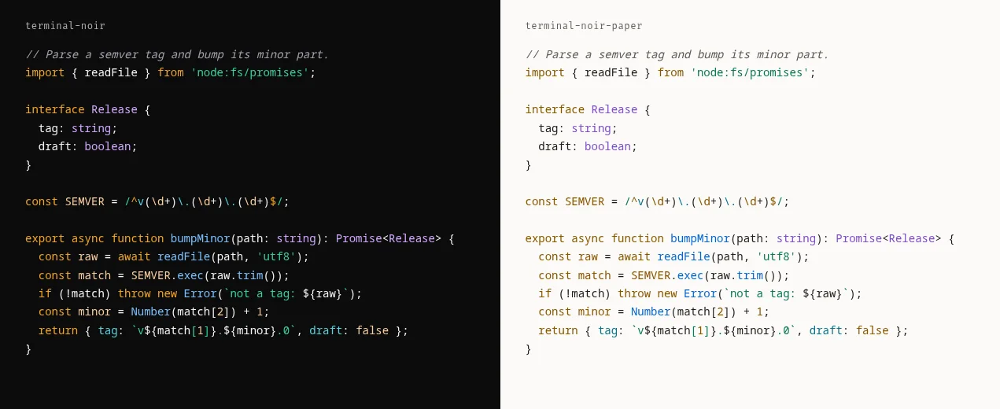
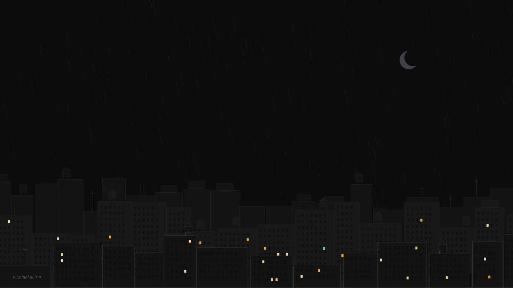
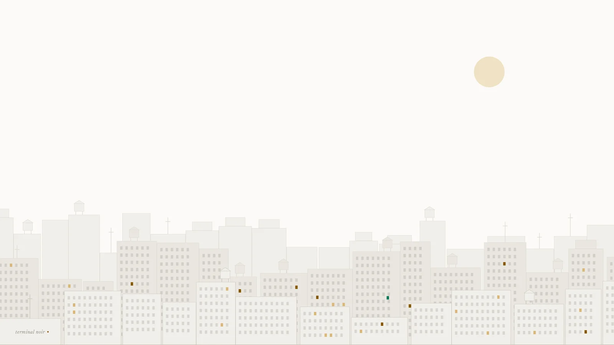

Terminal Noir started as the palette of my site and ended up as the theme of my whole system. First the Noctalia bar got the amber `#F5A623` from my site on the active workspace, the layout indicator and the timer ring. Then came the window border in niri, Ghostty, Chrome, and in a single night [Terminal Noir](https://github.com/nandomoreirame/terminalnoir) had a public repository, its own site and a `v0.1.0-beta` release.

When you take seriously the idea that your operating system can look like you, a palette turns into a dozen config files, the dozen files turn into a generator, and the generator forces you to measure things you would never measure from a screenshot. If you have used Linux long enough and have tried to make everything the same color, you know what I am talking about.

## Matching colors is a Linux-user thing

I really like having matching colors in my setup. That is a thing for people who have used Linux for many years, and after going through [Omarchy](https://omarchy.org) and landing on CachyOS it got more obvious: these systems let you customize everything, and the theme is just one more customization. It is very common to see Arch Linux `.dotfiles` with [niri](https://github.com/YaLTeR/niri) or Hyprland, with [Noctalia](https://noctalia.dev) or another bar, and a theme that paints every possible app with the same palette. That is amazing.

**Making my OS look like me is part of why I use Linux**, and I know some people think that is a waste of time (those people use the default theme and are happy, and that is fine). And I already had the theme: the design tokens of my site, which I had just redesigned and called Terminal Noir. Near-black, cold surfaces that only change in lightness, a single amber accent and an emerald green for status.

## From Noctalia to twelve apps in one night

Noctalia came first because it was right in front of me. Claude read the site's [`global.css`](https://github.com/nandomoreirame/nandomoreira.dev/blob/main/src/styles/global.css), mapped each token to the equivalent role on the bar (background, raised surface, text, accent) and used the light theme from the posts' reading mode as the light variant. niri came right after: the active window border, which was the default blue `#7fc8ff`, became amber.

After niri, I listed where else the theme fit, from cheapest to most work. The cheapest was Noctalia itself: version 5 has templates that generate themes for other apps from the active palette, and GTK came for free that way. The rest was file by file, and the theme reached Ghostty, VS Code, Cursor, bat, btop, fzf, Powerlevel10k, Obsidian and Chrome, all inside my dotfiles repository.

That is when the idea hit. [Dracula](https://draculatheme.com) and [Catppuccin](https://catppuccin.com) are exactly that: a palette and a bunch of "ports", one per app. The name was free (no "Terminal Noir" theme published for any editor, terminal or other tool), and what was scattered across my dotfiles became a separate project.

## One palette, and the rest is generated

The organization came from the projects I admire. Everything comes from two files: [`palette/palette.json`](https://github.com/nandomoreirame/terminalnoir/blob/main/palette/palette.json), with colors named by role and not by value, and [`palette/syntax.json`](https://github.com/nandomoreirame/terminalnoir/blob/main/palette/syntax.json), with syntax roles pointing at palette names, never at a loose hex.

```json
"surface": { "base": "#0B0B0C", "raised": "#121214", "elevated": "#18181B" },
"text":    { "primary": "#F4F4F5", "muted": "#A1A1AA", "faint": "#6B6B74" },
"accent":  { "primary": "#F5A623", "success": "#34D399" }
```

Each app got a script under [`scripts/ports/`](https://github.com/nandomoreirame/terminalnoir/tree/main/scripts/ports) that reads the palette with [jq](https://jqlang.org) and writes the file in the format the app understands: a plist for bat, a theme JSON for VS Code, a KDL for niri, a manifest with RGB colors for Chrome. Changing a color is editing one file and running [`make build`](https://github.com/nandomoreirame/terminalnoir/blob/main/Makefile). And so nobody forgets to run it, the [bats](https://github.com/bats-core/bats-core) tests ([`tests/build.bats`](https://github.com/nandomoreirame/terminalnoir/blob/main/tests/build.bats)) regenerate everything in a temporary folder and fail if what is committed diverges from what the palette produces.

Bash and jq were Claude's own choice, and I was happy to follow: a theme needs no runtime beyond what already ships on any Linux.

## The site, instead of a giant README

I started the site in [Stitch](https://stitch.withgoogle.com), Google's interface generator, with a prompt that asked for the best of both: from Dracula, the confident hero and the app grid; from Catppuccin, the palette as the star and the variant selector. The result was good enough to start, only too big, in width and in sections, so I went straight into code with a smaller site, few pages, like Catppuccin's: Home, About, Ports, Palette and Docs.

[terminalnoir.web.app](https://terminalnoir.web.app) is static Astro and has no hex written by hand in the CSS: at build time it reads the palette, the ports registry and each port's README. It shipped in English and Portuguese, and each port got a page with its screenshot. Deploy goes to Firebase Hosting on every push to `main` (GitHub Actions authenticates with Google Cloud with no key stored anywhere, via identity federation).

## What I had not measured: contrast

When I went to plan the light mode of my site using Terminal Noir's own Paper variant, before writing a line, I measured the contrast of each color against each surface, by the [WCAG 2.1](https://www.w3.org/TR/WCAG21/#contrast-minimum) formula (text needs 4.5:1; a border that delimits something clickable, 3:1).

Paper failed on 13 roles. Noir, on 2.

| Variant | Role | Value | Worst ratio | Fixed | Worst ratio |
|---|---|---|---|---|---|
| Paper | light cyan (ANSI) | `#3192AA` | 2.89 | `#0A7187` | 4.52 |
| Paper | light magenta (ANSI) | `#A475F9` | 2.60 | `#7C4BCB` | 4.52 |
| Paper | light blue (ANSI) | `#218BFF` | 2.72 | `#0666C5` | 4.54 |
| Paper | status green | `#047857` | 4.40 | `#0B7656` | 4.51 |
| Noir | outline | `#3F3F46` | 1.70 | `#64646B` | 3.02 |
| Noir | light black (ANSI) | `#6B6B74` | 3.36 | `#808089` | 4.53 |

Syntax roles point at the palette, so the error spread: in the light editor, types and properties sat between 2.6 and 3.5. Nobody would have noticed looking at the screenshots, because almost all of them are of the dark theme.

The fix became part of the project. I wrote the contrast formula in jq ([`scripts/lib/contrast.jq`](https://github.com/nandomoreirame/terminalnoir/blob/main/scripts/lib/contrast.jq), the formula fits in six lines) and a bats test ([`tests/contrast.bats`](https://github.com/nandomoreirame/terminalnoir/blob/main/tests/contrast.bats)) that measures every readable role on the three surfaces of each variant and fails the build if any falls below the floor. To fix them, each color kept its hue and only changed lightness, in small steps in [OKLCH](https://oklch.com) space, until the worst case passed. That was 15 colors, and every port was regenerated from them.

Two details that only show up by doing it: in jq, a parameter named `$floor` hides the `floor` function you call right below (the error that shows up has nothing to do with that); and Chrome rejects a manifest with `0.1.0-beta` in the version, because it only accepts numbers. The full label went into the `version_name` field ([`scripts/ports/chrome.sh`](https://github.com/nandomoreirame/terminalnoir/blob/main/scripts/ports/chrome.sh)).

## Code in the theme of the code

With the palette fixed, one thing was still missing on my site: the code blocks used a GitHub theme, which has nothing to do with the palette. So Terminal Noir got a port for [Shiki](https://shiki.style), the syntax highlighter Astro uses: two themes, [`terminal-noir`](https://github.com/nandomoreirame/terminalnoir/blob/main/ports/shiki/terminal-noir.json) and [`terminal-noir-paper`](https://github.com/nandomoreirame/terminalnoir/blob/main/ports/shiki/terminal-noir-paper.json), generated from the same `syntax.json` and tested token by token.



This post is already in it. The button in the footer switches between Noir and Paper, the first visit follows your system theme, and both pass the same contrast test.

## One city, two variants

A desktop theme without a wallpaper is half done, so I asked Stitch for two, one noir and one paper. The first ones used the terminal cursor as the motif and did not convince me. I asked for another concept, a noir city, and Stitch's generation simply never came back: it timed out and no new screen showed up in the project.

Then I put both to work, Stitch and Claude itself. Two very different noir skylines came out. Stitch's was taller, with large smooth buildings and almost every window dark, cleaner and more graphic. Claude's, drawn by a Python script, was lower, with three depth layers, water tanks, antennas, rain with threads of different lengths and about thirty windows lit in amber. I kept Claude's, which looked more like a real city.



In both versions there is a detail I like: a single emerald-green window among all the amber ones, the palette's status color hidden in the city.

For the Paper variant I wanted the same city, by day. Because it was a script, that came for free: the generator runs with the same random seed, so buildings, water tanks, antennas and windows stay identical and in the same place, and only the palette changes. The sky becomes paper-colored, the buildings go to light tones, the moon becomes a sand-colored sun, the rain and stars disappear, and the lit windows become reflections in dark amber. The green window is still there.



Contrast showed up here too. In Paper, the name "terminal noir" in the corner sat on top of a building's windows and lost readability, so the windows in that corner came out in both versions. Both files are in the repository at 3840×2160: [`noir.png`](https://github.com/nandomoreirame/terminalnoir/blob/main/assets/wallpapers/noir.png) and [`paper.png`](https://github.com/nandomoreirame/terminalnoir/blob/main/assets/wallpapers/paper.png).

## AI from start to finish

AI was used in 100% of the process. Claude Code wrote the palettes, the generators, the tests, the site, the contrast gate and the wallpaper city; Stitch designed the first version of the site.

What I did was decide: that the theme came from my site, that it became a project, that the site would be small, that Paper was only acceptable if it passed AA. All in one night, each step on top of the previous one.

## The next step is to leave my repository

Today each port installs by copying a file from the repository. Nobody discovers a theme that way: we discover it inside the app, in Noctalia's palette picker, in `ghostty +list-themes`, in the editor's extensions tab. The plan is already written: Noctalia's [community-palettes](https://github.com/noctalia-dev/community-palettes), [iTerm2-Color-Schemes](https://github.com/mbadolato/iTerm2-Color-Schemes), which feeds Ghostty's built-in themes, and, after the stable version, the VS Code Marketplace, Open VSX (where Cursor pulls themes from) and Obsidian's theme directory.

The code is in the [repository](https://github.com/nandomoreirame/terminalnoir), the site at [terminalnoir.web.app](https://terminalnoir.web.app), and the case in the [lab](/en/lab/terminal-noir), for anyone who wants to paint their own setup noir.

`make build`
