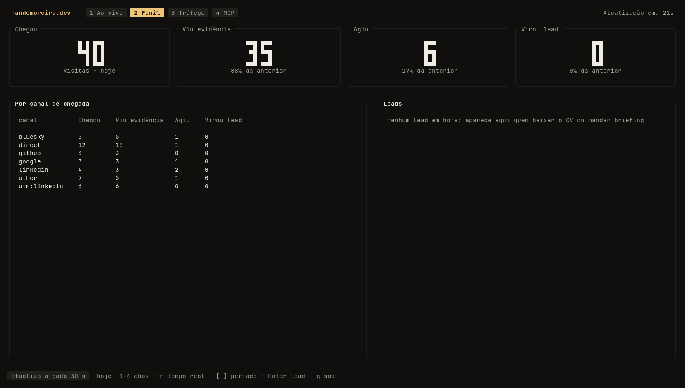
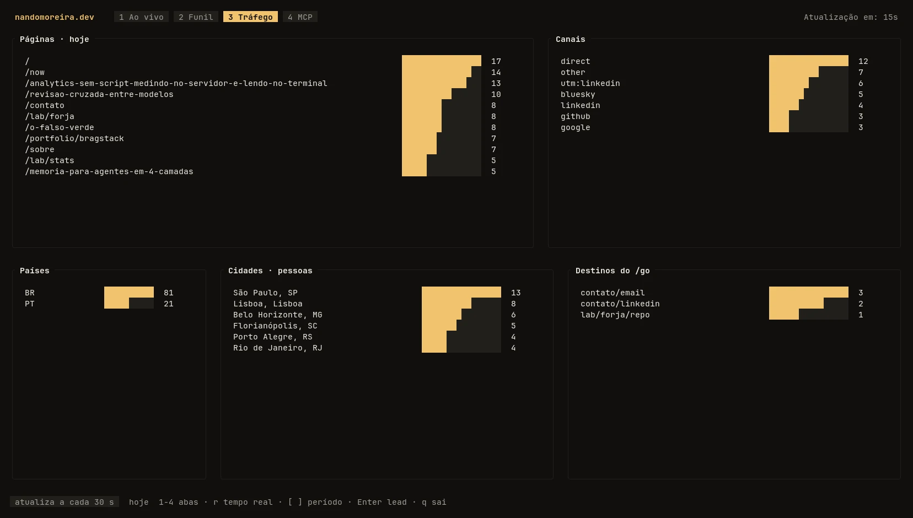
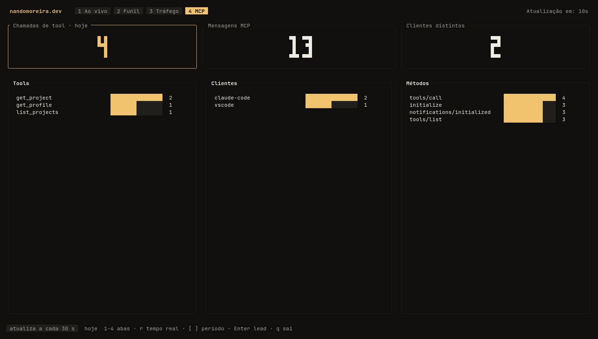
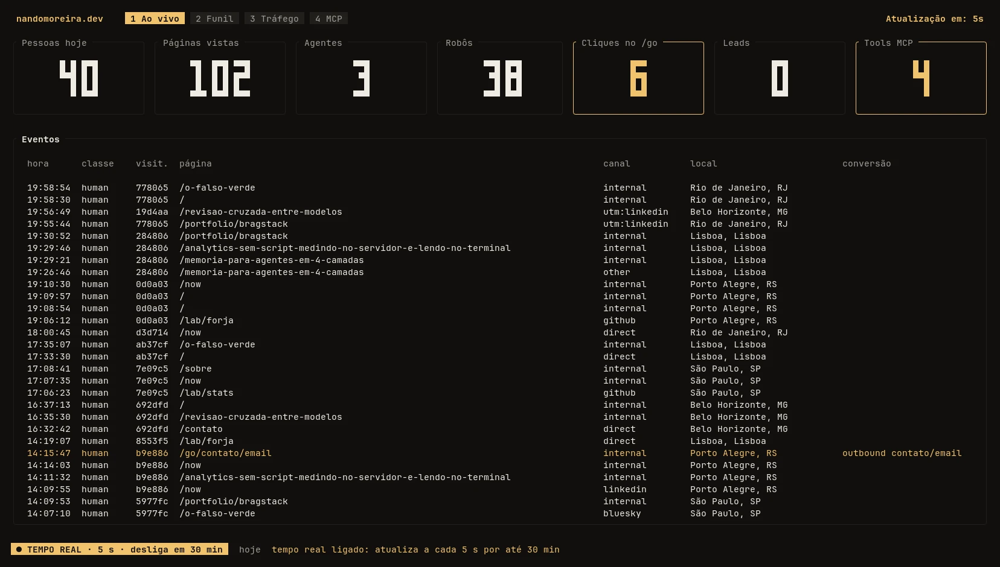

Abri o `stats` no terminal, apertei `r` para atualizar a cada 5 segundos e fui navegar pelo site no celular. `/now`, `/sobre`, `/contato`, `/mcp`: cada página aparecia no painel poucos segundos depois. Era exatamente o que eu queria ver funcionando, e era exatamente o que não devia aparecer, porque aquele celular estava marcado para não ser contado.

Esse foi o último bug de um dia inteiro tirando do papel um analytics feito em casa. Não é uma comparação de ferramentas nem um tutorial de como fazer o seu. É o que eu escolhi medir, como mediu, o que quebrou no caminho e o painel que eu uso para ler tudo isso.

## O básico, sem script no navegador

As ferramentas de analytics fazem muita coisa para um site pequeno. Eu queria só o básico: quantas pessoas chegam, de onde vieram, o que leram e se alguém virou contato. E não queria scripts sendo injetados no meu site sem necessidade.

O site já tinha uma regra escrita sobre isso. JavaScript no navegador só entra por exceção nomeada (hoje são o efeito do ponteiro, o botão Copiar e a prévia de áudio do `/now`), e um teste reprova o build se aparecer qualquer outro script. Um snippet de analytics seria mais uma exceção, e das grandes.

As alternativas também não fechavam a conta. Um Plausible ou Umami self-hosted significa mais infra e mais banco para manter num site que não paga nada disso. O Google Analytics resolve sem custo, mas aí os dados de quem visita o site, inclusive de quem depois vira cliente, vão parar num terceiro, com cookie de terceiro junto. **Se é para guardar dado de visitante, que fique no meu banco, com a regra que eu escrevi.**

O que entrou na medição, então: a página, o canal de chegada (o domínio de onde a pessoa veio, ou o `utm_source` do link), o país, se quem chegou é pessoa, agente de IA ou robô, e as conversões. Conversão aqui é briefing enviado pelo `/api/hire`, currículo baixado, chamada ao MCP do site e clique nos meus contatos ou nos links dos projetos.

## Contar no servidor, e um pixel onde o servidor não vê

A maior parte do site é renderizada a cada requisição, então a contagem mora no middleware do Astro: a resposta sai, e antes dela o servidor grava a visita. Os posts e os cases são outra história. Eles são pré-renderizados no build e o servidor Node os entrega como arquivo estático **antes** do middleware rodar. Para eles a contagem seria zero.

A saída foi o truque mais velho da web: uma imagem de 1×1 pixel, servida pelo próprio domínio, no fim de toda página pré-renderizada.

```html

```

O `/v.gif` lê o `Referer` para saber qual página o carregou, confere se ela existe no sitemap (um pixel chamado de fora não grava nada) e responde sempre o mesmo GIF transparente, com `no-store`. É uma imagem, não um script, então o portão de JavaScript continua do mesmo jeito.

Os cliques de saída passam por `/go/`. O link de "Código fonte" de um case aponta para `/go/lab/<slug>/repo`, que grava o clique e redireciona. O destino sai de uma tabela montada a partir do perfil e dos projetos, nunca da URL, então o `/go` não vira redirecionamento aberto para quem quiser usar o domínio como trampolim.

Um detalhe da plataforma decidiu como a gravação acontece. O site roda no Firebase App Hosting, em cima do Cloud Run, que corta a CPU quando a resposta termina. Gravar "em segundo plano" e devolver a página na hora parece educado, mas a gravação simplesmente não acontece. A escrita é aguardada, com um teto de 250 ms, e qualquer falha é engolida: medir nunca derruba uma página.

## Ligar as páginas sem cookie

Para saber que três páginas foram vistas pela mesma pessoa sem dar cookie para ninguém, o servidor calcula um código a partir do IP e do navegador, misturados com uma chave secreta que muda todo dia. O IP não é gravado, e o código de hoje não se liga ao de amanhã. O preço é aceito: o funil por pessoa só existe dentro de um dia, e quem troca de rede no meio da tarde vira duas visitas.

Os dados ficam no Firestore, que o site já usava para guardar os briefings, então não houve banco novo nem conta nova para pagar. Cada visita fica 30 dias e é apagada sozinha por TTL; depois disso sobram só totais por dia, sem código de visitante nenhum, por 24 meses. País e cidade vêm da Cloudflare, nos cabeçalhos `cf-ipcountry` e `cf-ipcity`, e a cidade fica só no registro de cada visita, nunca nos totais.

Quando alguém manda um briefing ou baixa o currículo, o e-mail que eu recebo traz as páginas que aquela pessoa viu no dia. E a política de privacidade foi reescrita para dizer isso com todas as letras, incluindo a parte que menos gente gosta de admitir: enquanto você só navega, nada diz quem você é, mas se você preencher o formulário, as páginas do seu dia vão junto com o seu nome.

## Ler no terminal

Para ler tudo isso eu não quis outro painel web. O `stats` é uma TUI em Rust, com ratatui, que mora no mesmo repositório do site em `tools/stats/`. Assim, quando o formato dos dados muda no site, o leitor muda no mesmo commit.

Ele lê o Firestore pela API REST com a credencial do `gcloud` que eu já uso no terminal. Se não houver login, ele mesmo roda o `gcloud auth application-default login`, o navegador abre e a TUI continua. São quatro abas:

| Aba | O que mostra |
|---|---|
| Ao vivo | Totais de hoje em números grandes e o feed de eventos, com as conversões em âmbar |
| Funil | Chegou, viu um case ou post, clicou num link, virou lead; no total e por canal de chegada |
| Tráfego | Páginas, canais, países, cidades e destinos do `/go` mais clicados |
| MCP | Chamadas por tool, por cliente e por método |

Os prints abaixo são do `stats --demo`, que gera 30 dias de visitas inventadas sem tocar no Firestore. Os números são de mentira; as telas são as de verdade.







A atualização é a cada 30 segundos. O Firestore cobra pelo menos uma leitura por consulta, mesmo vazia, então o modo de 5 segundos (a tecla `r`) desliga sozinho depois de 30 minutos. É para acompanhar o momento logo depois de publicar um post, e é fácil esquecer ligado.



## O que quebrou

O primeiro tropeço veio antes de o código chegar em produção. Para conferir o deploy, rodei um `curl` no `/v.gif` quando a rota ainda não existia. A resposta foi um 404 com `cache-control: max-age=1800`, e a Cloudflare, que trata `.gif` como arquivo estático, guardou esse 404 na borda por meia hora. Depois do deploy a rota respondia certinho na origem, mas quem pedia pela URL normal recebia o 404 do cache. Resolveu limpando só essa URL no painel da Cloudflare.

O segundo foi o celular da abertura. Para eu não contar minhas próprias visitas, o site tem uma rota `/eu` que, com o token certo, grava um cookie no navegador, e o servidor ignora quem chega com ele. Marquei o celular, o iPad e o notebook. Abri o `stats`, liguei os 5 segundos e as minhas páginas apareceram todas. O `Set-Cookie` chegava ao navegador direitinho. O que não chegava era o cookie de volta: uma requisição com `Cookie: nm_self=1` foi gravada como visita normal. O Firebase Hosting é conhecido por repassar ao servidor só o cookie chamado `__session` e descartar o resto no caminho, e o App Hosting se comportou do mesmo jeito. O cookie virou `__session=self`, marquei os três aparelhos de novo e as minhas visitas sumiram da contagem.

O terceiro foi de rótulo. O card "Pessoas hoje" mostrava o contador de páginas vistas por pessoas, então cada página que eu abria somava um. Agora ele conta visitantes diferentes do dia, e as páginas vistas ganharam um card próprio.

E teve o que a revisão de código pegou antes de ir ao ar. O que mais mudaria os números era o MCP: toda mensagem do protocolo contava como conversão, então um único uso real (`initialize`, `notifications/initialized`, `tools/list` e a chamada de tool) somava quatro. Só a chamada de tool conta agora.

## Começando do zero

Ao fim do dia apaguei todos os dados de medição, inclusive os meus testes, e o painel começou zerado. Não tem número neste texto porque ainda não tem número que valha a pena: a ideia é acompanhar cada post que eu divulgar nas redes e ver no `stats` o que de fato traz leitor e o que traz contato.

`ratatui::restore();`
