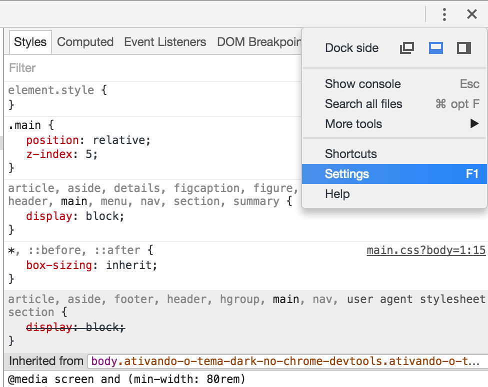
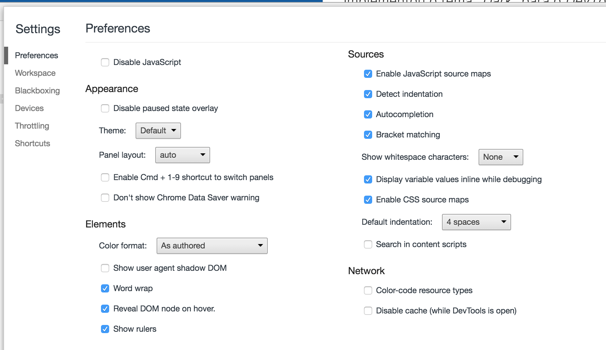
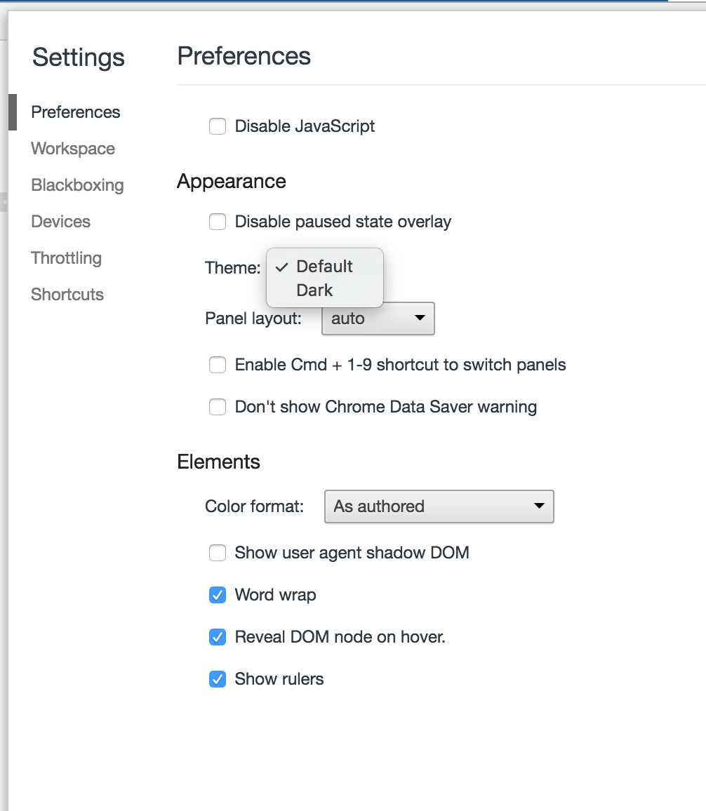
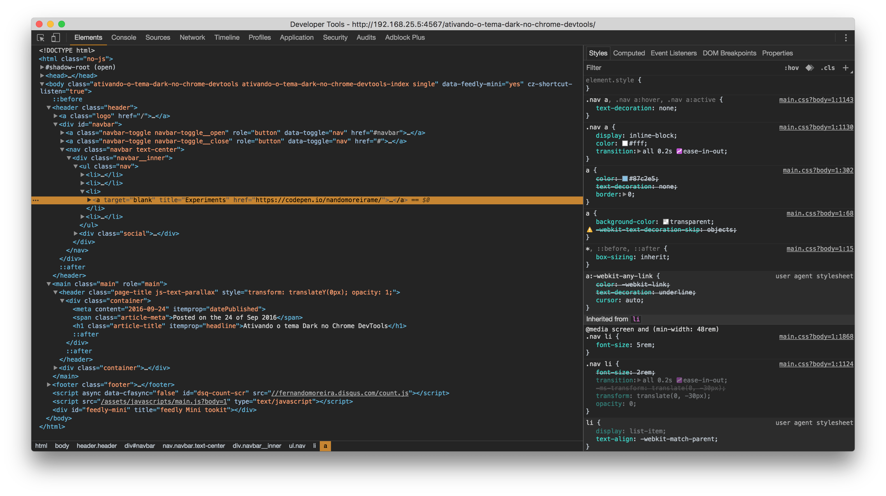

O [Google Chrome](https://www.google.com/chrome/) em uma de suas atualizações implementou o tema _"Dark"_ para o _Chrome DevTools_. Isso já faz uns 7 a 8 meses mais ou menos (eu acho), mas estou escrevendo esse pequeno artigo pra avisar os que ainda estão desavisados.

### A surpresa de alguns

Estávamos no Meetup de Front-end aqui em Curitiba, onde palestrei sobre [Jekyll](https://jekyllrb.com/), e em um determinado momento precisei abrir o navegador e inspecionar alguns elementos no Google Chrome, o tema _"default"_ do _DevTools_ não ficou muito bem aos olhos de quem estava vendo de longe, então eu abri o _Settings_ e troquei de _"default"_ para _"dark"_ e tudo ficou perfeito.

Confesso que fiquei um pouco **_#HashTagXatiado_** com a surpresa de alguns na sala, realmente eles desconheciam tal funcionalidade.

### Como proceder

A parada é tão simples que nem sei se devo explicar ilustrando com imagens, mas vou mesmo assim. hehehee

---

#### 1. Abra o _Settings_ (F1) do seu _DevTools_

---

#### 2. Logo na primeira abra vá até "Theme" e troque no select de "Default" para "Dark"

---

Ele vai dar um _refresh_ (acho que reiniciando) e **BAZINGA!** o seu DevTools está todo **Black Metal**!! 🤘

Dica simples e útil (ou não).

Obrigado, de nada.

Valeu, falou.

`{{end}}`
