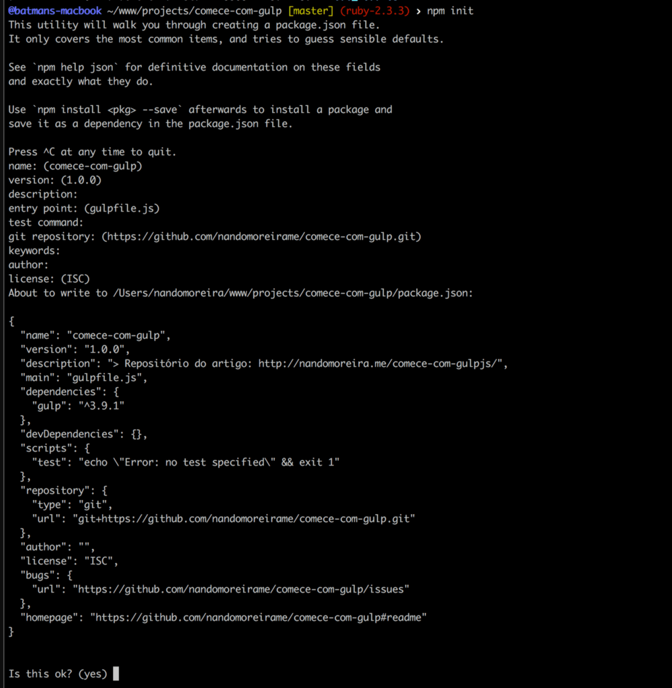
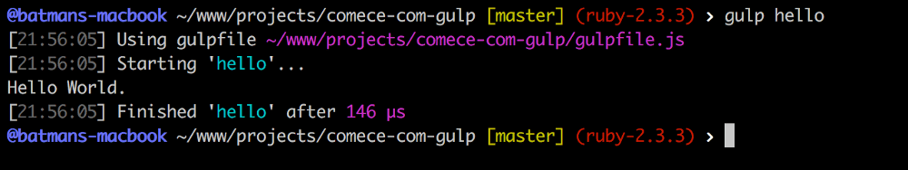
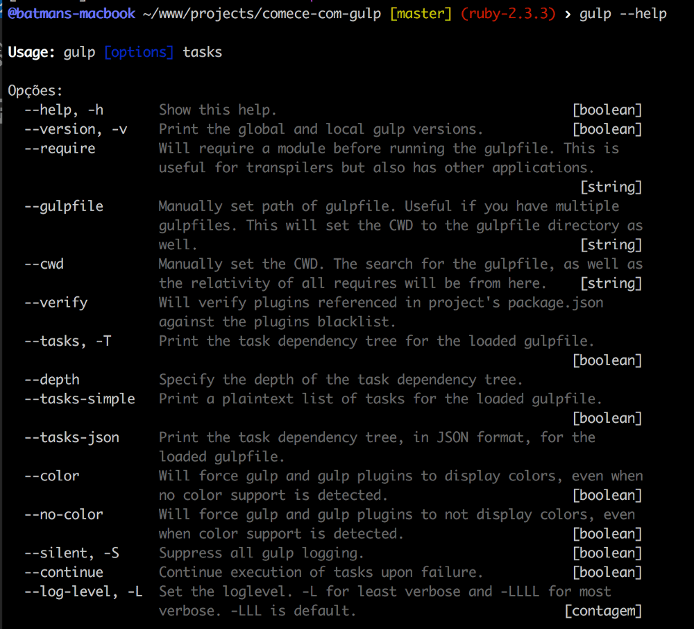
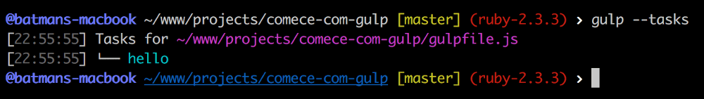

Automatizadores de tarefas ou como são conhecidos pelo termo em inglês [Task Runners](https://goo.gl/Zugcvt), tem a capacidade de fazer muita coisa, facilitam muito não só no desenvolvimento dos projetos mas também nos builds e deploys, cara é simplesmente lindo.

Já usei o [Gruntjs](http://gruntjs.com/) e [Rake tasks](https://github.com/ruby/rake) do Ruby, ambos são muito bons e tem suas finalidades, mas hoje vou falar sobre o magnífico [GulpJS](http://gulpjs.com/).

## Poque eu deveria usar um Task Runner?

Usar um automatizador de tarefas te traz muitas vantagens, das quais se você desfrutar nunca mais vai querer começar o desenvolvimento de um novo projeto sem elas.

Abaixo eu vou listar algumas, se não te fizer brilhar os olhos você talvez não precisará de um **task runner**.

Com apenas um comando você consegue:

- Fazer a compressão de centenas de imagens de um projeto antigo (eu precisei fazer isso);
- Deploy para qualquer servidor sftp, ssh ou até mesmo para amazon S3;
- Fazer Watch de pré-processadores e template engines;
- Subir servidores locais de qualquer linguagem;
- Executar os testes do seu projeto;
- Executar tarefas complexas em segundos;
- … e ter mais tempo para tomar um café.

E ai gostou? Ainda tem mais vantagens que não foram listadas acima, essas são as que eu mais gosto de citar quando me perguntam quais as vantagens de um Task Runner.

Eu sempre gosto de dizer: “Ele me faz ter mais tempo para o meu café”.

## Porque eu deveria usar o GulpJS?

O Gulp te dá todas as vantagens que citei no bloco anterior, além de:

- Ser super-rápido. Performance com certeza é uma vantagem grande do Gulpjs;
- Simples e fácil de implementar. Ele é simples e direto, com certeza você vai gostar;
- Quantidade enorme de plugins em seu repositório. O que você imaginar o Gulp tem um componente para isso.
- … e muito mais.

> “gulp is a toolkit for automating painful or time-consuming tasks in your development workflow, so you can stop messing around and build something."

Essa frase acima está na homepage do gulp, ela te dá um breve overview do que você irá encontrar se começar a se aventurar com ele.

## Instalação e configuração do Gulp

Vamos criar um projeto simples, apenas para executar algumas tarefas com Gulp, o nome do projeto será [Comece com gulp](https://github.com/nandomoreirame/comece-com-gulp), e claro, ele tá lá no Github.

😎

Instale o Gulp global com o comando: `npm install -g gulp-cli`.

> **PS. em alguns sistemas operacionais, se você não estiver usando NVM para gerenciar suas versões do nodejs, você precisará executar o comando com SUDO.**

Inicie o projeto npm com o comando: `npm init`.



Esse comando irá criar um arquivo chamado **package.json**, com ele você gerencia todos os pacotes e dependências do seu projeto.

O meu **package.json** ficou mais ou menos assim:

```json
{
  "name": "comece-com-gulp",
  "version": "1.0.0",
  "description": "> Repositório do artigo: http://nandomoreira.me/comece-com-gulp",
  "main": "gulpfile.js",
  "dependencies": {
    "gulp": "^3.9.1"
  },
  "devDependencies": {},
  "scripts": {
    "test": "echo \"Error: no test specified\" && exit 1"
  },
  "repository": {
    "type": "git",
    "url": "git+https://github.com/nandomoreirame/comece-com-gulp.git"
  },
  "author": "",
  "license": "ISC",
  "bugs": {
    "url": "https://github.com/nandomoreirame/comece-com-gulp/issues"
  },
  "homepage": "https://github.com/nandomoreirame/comece-com-gulp#readme"
}
```

Instale o Gulp local com o comando: `npm install --save-dev gulp` ou `yarn add -D gulp`

Você vai notar que na linha onde tinha `"devDependencies": {}`, foi adicionado o gulp.

```json
"devDependencies": {
  "gulp": "^3.9.1"
},
```

O gulp agora faz parte das dependências de dev do seu projeto, assim como os módulos que iremos instalar para ajudar na execução das tarefas.

## Hello World com Gulp

Dentro do projeto temos o arquivo **package.json** e o diretório **node_modules** onde está instalado o Gulp local.

Vamos criar o arquivo chamado **gulpfile.js**, que é obrigatório para criarmos as tarefas do Gulp.

```bash
$ touch gulpfile.js
```

Nesse arquivo vamos requerir o Gulp usando [CommomJS](https://pt.wikipedia.org/wiki/CommonJS): `require('gulp');`.

```javascript
'use strict'

var gulp = require('gulp')
```

Na primeira linha temos o `'use strict';`, se você não sabe para que serve o `‘use strict’;` eu indico assistir a palestra de [Javascript Secrets](https://youtu.be/7Ur9zN2vMcs?t=1m7s) do Fernando Daciuk, muito legal. Já na segunda linha criamos uma variável chamada **gulp**, a qual iremos usar muito por todo nosso código.

Vamos ao Hello World.

```javascript
'use strict'

var gulp = require('gulp')

gulp.task('hello', function() {
  console.log('Hello World.')
})
```

Basta rodar o comando `gulp hello` no seu terminal que a mágica vai acontecer.



## Comandos

Você pode obter a lista de comandos do Gulp apenas digitando o commando `gulp --help` no seu terminal.



Um comando bem interessante é o que lista todas as tasks do projeto `gulp --tasks`.



## Concluindo..

Esse foi apenas o primeiro passo para você começar com Gulpjs, vai por mim, tem muitas coisas legais que da pra fazer com uma task do gulp. Espero que tenha gostado do artigo, é simples mas útil.

Logo mais vou fazer outro artigo um pouco mais avançado para você ir mais além com ele.

Até breve.

`/end`
