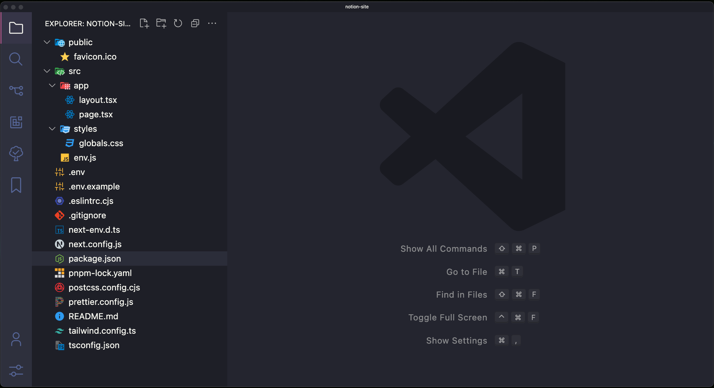
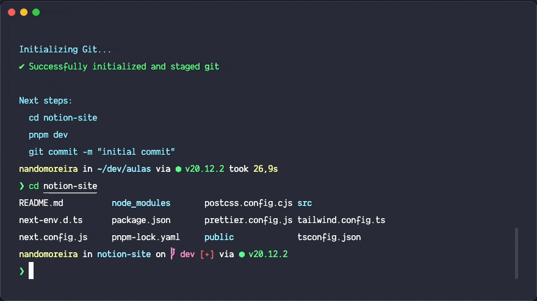
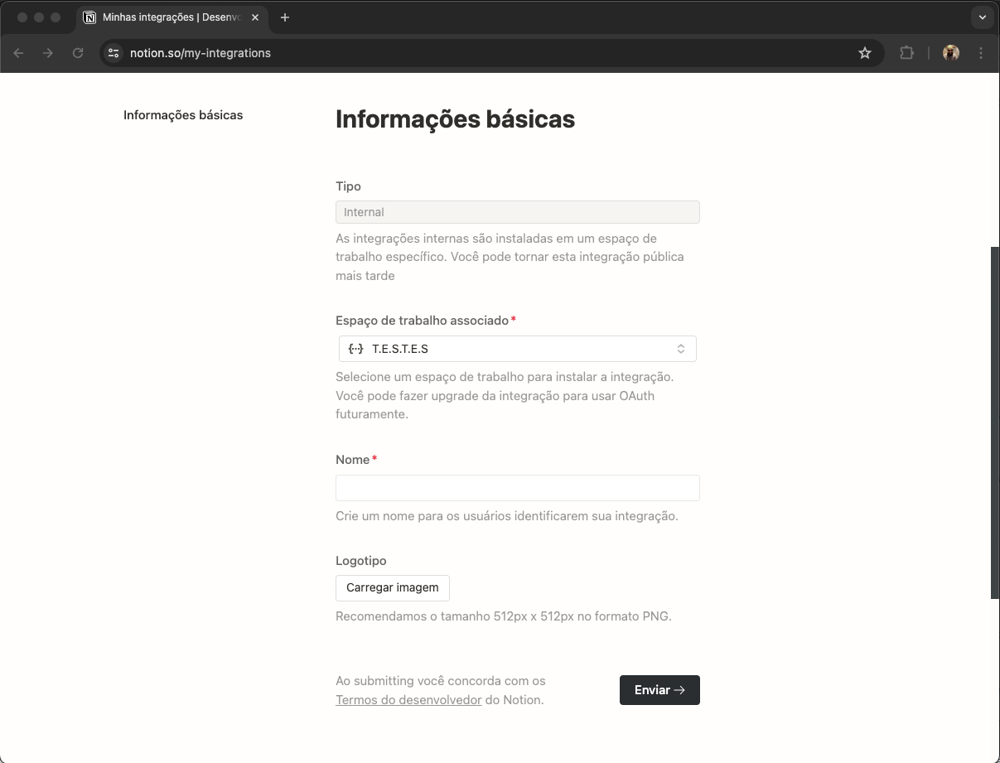
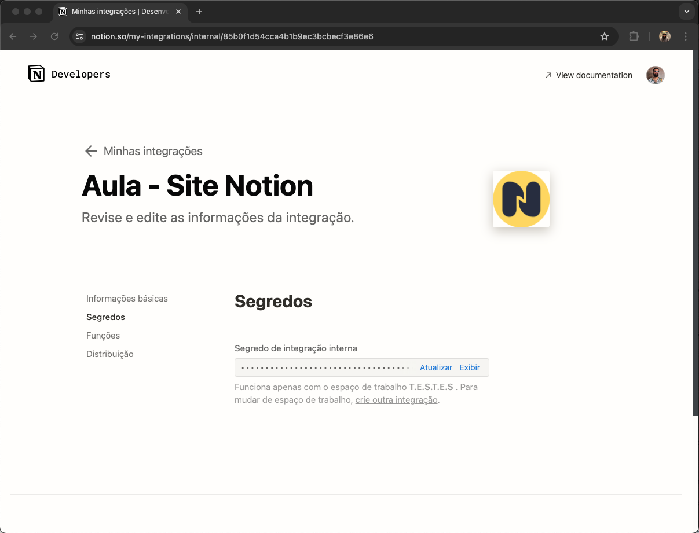

> **Nota de 2026:** a série que este post anuncia parou aqui, no primeiro capítulo. O código do que foi feito continua no [repositório do projeto](https://github.com/nandomoreirame/notion-site).

Olá dev! 👋🏼 

Estou muito feliz em recebê-lo aqui! É uma honra e um prazer compartilhar minhas experiências com você.

A ideia desse artigo é dar uma introdução de como criar um site completo usando o **Notion** como gerenciador de conteúdo (CMS). Esse é o primeiro de muitos, então prepara seu café, sua água e vamos codar!

---

## Iniciando o projeto next

Inicie o seu projeto nextjs com o [create-next-app](https://nextjs.org/docs/pages/api-reference/create-next-app) ou com o [t3-app](https://create.t3.gg/), eu vou optar pelo t3-app e o [pnpm](https://pnpm.io/pt/) gerenciador de pacotes:

```bash
pnpm create t3-app@latest
```


Terminal executando o comando `pnpm create t3-app@latest` e respondendo as perguntas do start t3-app.

---

### Instalando o Notion Client

Após finalizar a instalação e setup das perguntas do seu boilerplate escolhido, abra o seu projeto no seu editor favorito, eu uso o famoso vscode por aqui.

Você verá algo parecido com isso:



Estrutura inicial de arquivos e diretórios do projeto criado com o t3-app.

Agora dentro do diretório do projeto (`cd /notion-site`) iremos instalar como dependência o pacote [@notionhq/client](https://www.npmjs.com/package/@notionhq/client) para ter acesso a [API do Notion](https://developers.notion.com/).

```bash
pnpm add -S @notionhq/client
```



Terminal executando a instalação do pacote @notionhq/client como dependência do projeto.

---

## Criando a lib do notion

Nosso site vai interagir diretamente com a API externa do Notion, então para que isso funcione devidamente precisaremos criar uma nova “integração” no painel de integrações do Notion:

1. Abra o site [https://www.notion.so/my-integrations](https://www.notion.so/my-integrations);
2. Clique em “Nova integração” ou “New integration” se seu Notion estiver em inglês;
3. Escolha o seu Espaço de trabalho (workspace), preencha o Nome da integração e adicione um logo se preferir;
4. Clique no botão “Enviar”





Com a nossa integração de API criada vamos copiar o **Segredo de integração interna** e adicionar em uma variável de ambiente em nosso projeto.

Abra o arquivo `.env` que está localizado no diretório raiz do seu projeto (se não tiver crie um).

 

```
NOTION_ACCESS_TOKEN="secret_c2vjRPEG1WNx3K38hKc9zajuSQLu2vZYRJbqSOtcOOr"
```

Em seguida, dentro do diretório `src/` vamos criar um outro diretório chamado `lib/` e dentro dele um arquivo chamado `notion.ts` , nele iremos criar todas as funções que interagem com a API do Notion.

```tsx
import { env } from "@/env";
import { Client } from "@notionhq/client";

const client = new Client({
	// a NOTION_ACCESS_TOKEN é uma variável de ambiente contendo
	// o integration Token do Notion
	// - se preferir pode puxar do sistema com process.env.NOTION_ACCESS_TOKEN
  auth: env.NOTION_ACCESS_TOKEN,
});
```

---

## Concluindo

Como o projeto é grande eu vou dividi-lo em pequenos posts e esse é o primeiro de muitos dessa série.

O [repositório](https://github.com/nandomoreirame/notion-site) do projeto está no meu [github](https://github.com/nandomoreirame) e lá você vai encontrar 2 branchs, a `main` onde temos apenas o boilerplate do projeto vazio e a `dev` onde eu farei o progresso de cada post em um commit.

---

Obrigado novamente por sua visita! Estou muito feliz em tê-lo aqui e mal posso esperar para compartilhar essa jornada com você!

Até mais! 👋🏼
