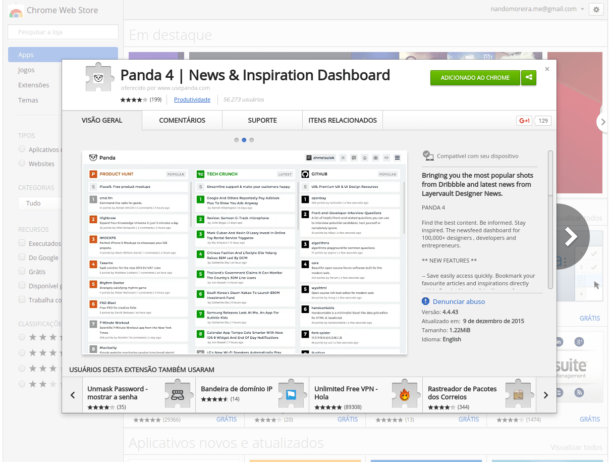

> **Nota de 2026:** o site original do Panda saiu do ar. Os links abaixo apontam para uma cópia guardada no Internet Archive.

Essa é uma dica rápida para os amantes da web, quem gosta, ama e trabalha com desenvolvimento de interfaces para o usuário.

## O que é?

O [Panda 4 - News & Inspiration Dashboard](https://web.archive.org/web/20161119000357/http://usepanda.com/app/) é um dashboard (painel) com feeds de websites, one pages, imagens, fotos e projetos inspiradores para quem gosta de apreciar essa arte.

Ele tem a versão [web](https://web.archive.org/web/20161119000357/http://usepanda.com/app/) e extensões para [Firefox](https://addons.mozilla.org/en-US/firefox/addon/panda-daily-news/) e [Google Chrome](https://chrome.google.com/webstore/detail/panda-4-news-inspiration/haafibkemckmbknhfkiiniobjpgkebko). Eu uso ele nos dois navegadores (Firefox e Chrome).

Acho incrivel apreciar o trabalho de grandes mentes do mundo web e sempre que preciso buscar uma inspiração pra algo que estou criando é nesses sites que encontro o que preciso.

## Isso não é só para designers

Como eu disse [nesse artigo aqui](/nao-seja-apenas-um-recortador-de-psd), um front-end com um bom lado criativo tem o seu valor e demonstra ser capaz de criar interfaces sem precisar da ajuda de um designer.

Navegue, pesquise, busque coisas novas. E [use panda](https://web.archive.org/web/20161119000357/http://usepanda.com/app/)! :D

/end.
