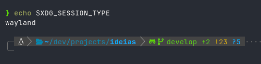
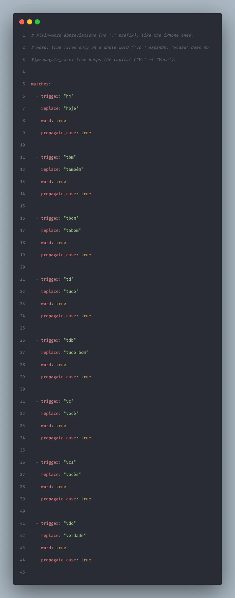

No iPhone eu digito `vc` e sai "você", digito `.email` e sai meu e-mail inteiro. Usei o macOS por alguns anos com a mesma "Substituição de texto" configurada, e a lista cresceu junto: endereço, CNPJ, link do WhatsApp, `(╯°□°)╯︵ ┻━┻` para os dias difíceis. No CachyOS, isso não existia, e fazia falta.

Minha primeira ideia foi escrever uma ferramenta para isso. Não precisou: o [espanso](https://github.com/espanso/espanso) existe desde 2019, é escrito em Rust, roda em Linux, macOS e Windows, e estava com release nova (2.4.1) quando instalei. O que a documentação não deixa claro é o que muda quando o seu desktop é Wayland, com um compositor que não é GNOME nem KDE. Aqui é CachyOS com Niri, e foram três ajustes até ficar redondo.

## O que o espanso faz

Ele fica escutando o teclado e, quando você termina de digitar um gatilho, apaga o gatilho e coloca o texto no lugar. Funciona em qualquer campo de texto: navegador, terminal, chat, editor. Os atalhos ficam em arquivos YAML dentro de `~/.config/espanso/match/`, e ele recarrega sozinho quando você salva.

```yaml
matches:
  - trigger: ".email"
    replace: "voce@exemplo.com"
```

Além de texto fixo, ele aceita variáveis (data, hora, saída de comando, clipboard), formulários e regex. Além das datas, uso pouco disso; a graça para mim é a lista de atalhos curtos que já mora na minha memória muscular.

## Instalando em cada distro

Primeiro descubra se a sua sessão é X11 ou Wayland, porque o espanso tem um build para cada:

```bash
echo $XDG_SESSION_TYPE
```



No Wayland ele lê o teclado direto do kernel (evdev), então o binário precisa de uma capability extra. Esse `setcap` aparece em todas as instalações Wayland abaixo, e esquecer dele dá o pior sintoma possível: o espanso roda, mas não vê nenhuma tecla.

### Arch, CachyOS e Manjaro

Vem do AUR, que compila Rust, então leva alguns minutos:

```bash
paru -S espanso-wayland   # ou espanso-x11
espanso service register
espanso start
```

O pacote do AUR já aplica o `setcap` sozinho na instalação.

### Ubuntu e Debian

Para Wayland:

```bash
wget https://github.com/espanso/espanso/releases/latest/download/espanso-debian-wayland-amd64.deb
sudo apt install ./espanso-debian-wayland-amd64.deb
sudo setcap "cap_dac_override+p" $(which espanso)
espanso service register
espanso start
```

Para X11, troque o `.deb` por `espanso-debian-x11-amd64.deb` e pule o `setcap`.

### Fedora

Depois de habilitar o [repositório Terra](https://developer.fyralabs.com/terra/installing):

```bash
sudo dnf install espanso-wayland   # ou espanso-x11
sudo setcap "cap_dac_override+p" $(which espanso)
espanso service register
espanso start
```

### Outras distros

Com X11, há uma AppImage que roda em qualquer distro, e dá para compilar do código-fonte nos dois casos. Os comandos estão na [página de instalação para Linux](https://espanso.org/docs/install/linux/).

## O primeiro start que dizia que tinha dado certo

Instalei, rodei `espanso service register` e `espanso start`. A saída foi esta:

```text
unable to start service: timed out
```

E o código de saída foi 0. Meu script de setup leu o 0, imprimiu um check verde e seguiu em frente com o espanso parado (o tipo de verde que eu já aprendi a desconfiar). O `espanso status` contava a verdade: `espanso is not running`.

A causa estava numa janela. Na primeira execução, o launcher abre uma tela de boas-vindas e só sobe o daemon depois que alguém clica nela; o timeout era ele esperando o meu clique. Fui ao código-fonte e, no Linux, essa tela é a única página do assistente. Ela é pulada quando existe um arquivo com uma preferência gravada em JSON:

```bash
mkdir -p ~/.cache/espanso/kvs
printf 'true' > ~/.cache/espanso/kvs/has_completed_wizard
```

Clicar na janela resolve do mesmo jeito. O arquivo é para quando a instalação roda sozinha, num OS novo, sem ninguém olhando. E a regra que ficou: depois do `start`, quem diz se subiu é o `espanso status`, não o exit code.

## Três ajustes no default.yml

Esta é a minha `config/default.yml`, com o porquê de cada linha:

```yaml title="config/default.yml"
keyboard_layout:
  layout: "us,br"
  variant: "intl,"

backend: Clipboard
preserve_clipboard: true

search_shortcut: off
```

O layout precisa ser declarado. Fora do GNOME e do KDE, o espanso não consegue descobrir o layout ativo no Wayland (o log avisa com `keyboard layout watcher couldn't determine active layout`). Eu copiei o bloco `xkb` do meu `config.kdl` do Niri, que usa `us` internacional com `br` de segunda opção. Se você usa ABNT2 puro, é `layout: "br"`.

O texto entra pela área de transferência. O padrão do espanso é simular as teclas, e **no `us-intl` isso é armadilha**: aspas simples e aspas duplas são teclas mortas. Um `'` injetado seguido de `c` vira `ç`, e o texto chega estragado. Com `backend: Clipboard`, ele cola o texto e devolve o que estava no clipboard antes.

O atalho de busca saiu. O espanso abre uma busca de atalhos com Alt+Espaço, que no meu Niri é a tecla que alterna entre os layouts `us` e `br`. Desliguei a busca.

## Por que os meus atalhos começam com ponto

A convenção da documentação é começar o gatilho com dois-pontos: `:email`. Durou pouco: em vários apps (Slack, Discord, GitHub) o `:` seguido de letras abre o seletor de emojis, e o seletor aparecia antes de o espanso trocar o texto.

Voltei para o ponto, que é como eu já fazia no iPhone. O ponto tem o problema contrário: ele aparece no meio de domínio, nome de arquivo e versão. Sem cuidado, `nandomoreira.site` viraria `nandomoreirahttps://...`. A opção `left_word` resolve, porque o gatilho só dispara no começo de uma palavra:

```yaml
  - trigger: ".site"
    left_word: true
    replace: "https://seusite.dev"
```

Os atalhos sem ponto, como `vc` e `tbm`, pedem a palavra inteira (`word: true`), senão `vcard` viraria `vocêard`. E `propagate_case` mantém a maiúscula: `Vc` vira "Você".

```yaml
  - trigger: "vc"
    replace: "você"
    word: true
    propagate_case: true
```



Uma coisa eu descobri testando, e conto porque vai acontecer com quem vem do iPhone. Lá a troca acontece quando você digita o espaço depois do atalho. Testei o `@@` depois de uma palavra e saiu `contato @nandomoreira.dev`, com um espaço sobrando. O espaço era meu: eu digitava achando que era ele que disparava a troca. No espanso, o atalho com ponto expande no instante em que você termina de digitar, sem esperar espaço nenhum. Só os de palavra inteira (`word: true`) esperam um separador, e esse separador fica no texto.

## Como eu organizei os 41 atalhos

Tirei print da lista nos Ajustes do iPhone, passei tudo para YAML e separei em quatro arquivos dentro de `match/`:

| Arquivo | O que tem |
|---|---|
| `base.yml` | Contato e links (e-mail, site, GitHub, WhatsApp) e datas |
| `personal.yml` | Documentos e endereço |
| `abbrev.yml` | Abreviações sem ponto: `vc`, `vcs`, `tbm`, `hj`, `td`, `vdd` |
| `fun.yml` | Risadas, `(╯°□°)╯︵ ┻━┻`, `¯\_(ツ)_/¯` e as piadas internas |

Os dados pessoais ficam num arquivo separado de propósito: se um dia essa pasta for parar num repositório público, sei exatamente o que tirar.

Dois recursos que valeram a pena. Um atalho pode ter mais de um gatilho, o que limpou as duplicatas que eu carregava do iPhone (`.wa` e `.whats` levavam ao mesmo link):

```yaml
  - triggers: [".wa", ".whats"]
    left_word: true
    replace: "https://wa.me/5511900000000"
```

E as datas, que o iPhone não faz, saem no formato brasileiro:

```yaml
  - trigger: ".hoje"
    left_word: true
    replace: "{{today}}"
    vars:
      - name: today
        type: date
        params:
          format: "%d/%m/%Y"
```

Quando um atalho não funciona depois de salvar, quase sempre é indentação do YAML. Dois comandos mostram onde:

```bash
espanso match list                     # o que ele carregou de fato
grep ERROR ~/.cache/espanso/espanso.log
```

## Num OS novo, sem lembrar de nada

A pasta `~/.config/espanso` aqui é um link simbólico para os meus dotfiles, então os atalhos viajam com o resto da configuração. Num OS novo, o setup instala o `espanso-wayland`, confere a capability, marca a tela de boas-vindas como vista, registra o serviço e só dá verde quando o `espanso status` confirma. Cada passo só roda se a verificação dele falhar, e um `--check` repete as verificações sem mudar nada.

Fiquei com o espanso e não escrevi ferramenta nenhuma. E, pra ser sincero, gostei muito mais de como ele resolve esse problema do que da Substituição de texto do iPhone e do macOS. Lá é uma lista de atalho e texto, e só. Aqui eu tenho data no formato que eu quiser, mais de um gatilho para o mesmo texto, controle de quando o atalho dispara (começo da palavra, palavra inteira, maiúscula mantida) e tudo num arquivo que eu versiono junto com o resto da minha configuração. **Eu decido o que é escrito e como é escrito.**

Os três ajustes acima agora estão no script, e um OS novo já nasce com os meus atalhos.

`{{end}}`
