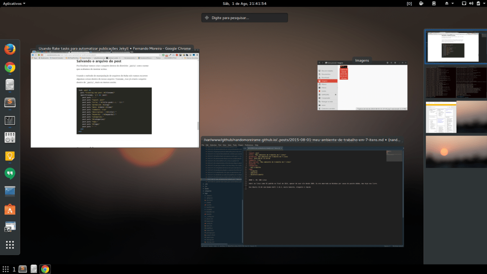
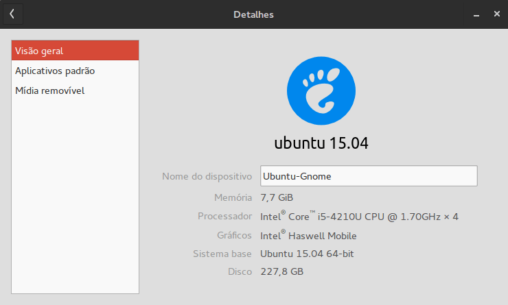
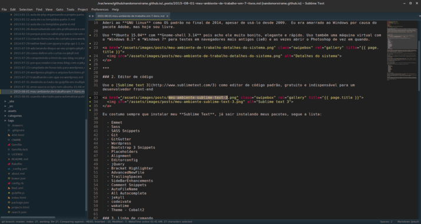
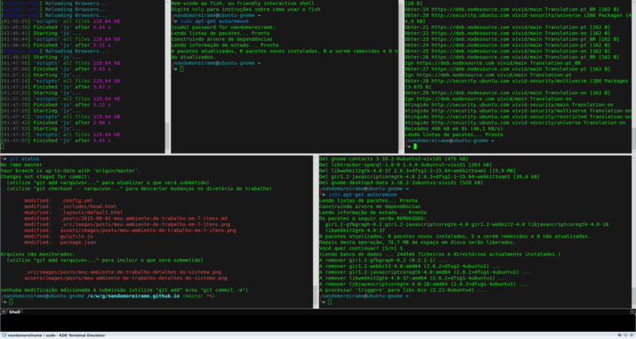
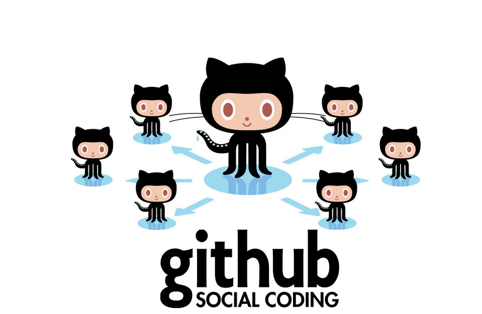
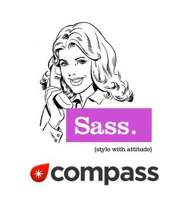
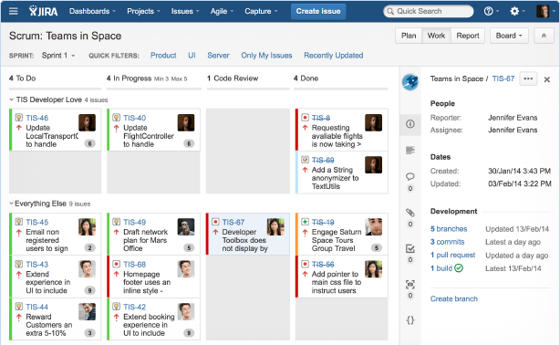

## 1. Sistema Operacional - Hoje sou livre!

Aderi ao **GNU linux** como OS padrão no final de 2014, apesar de usá-lo desde 2009. Eu era amarrado ao Windows por causa do pacote Adobe, mas hoje sou livre.

Uso **Ubuntu 15.04** com **Gnome-shell 3.14** pois acho ele muito bonito, elegante e rápido. Uso também uma máquina virtual com o _Windows 8.1_ e _Windows 7_ para testes em navegadores mais antigos (ie8) e as vezes abrir o Photoshop de vez em quando.

---

## 2. Editor de código

Uso o [Sublime text 3](https://www.sublimetext.com/3) como editor de código padrão, gratuito e indispensável para um desenvolvedor front-end

Eu costumo sempre que instalar meu **Sublime Text**, já sair instalando meus pacotes, segue a lista:

- Emmet
- Sass
- SASS Snippets
- Git
- GitGutter
- Wordpress
- Bootstrap 3 Snippets
- Placeholders
- Alignment
- Editorconfig
- jQuery
- Bracket Highlighter
- AdvancedNewFile
- TrailingSpaces
- SideBarEnhancements
- Comment Snippets
- AutoFileName
- All Autocomplete
- jekyll
- codeivate
- wakatime
- Theme - Cobalt2

---

## 3. Linha de comando

Usei por algums meses o **[Guake Terminal](http://guake.org/)** pelo simples fato de ser _dropdown_, logo migrei para o **[Terminator](https://gnometerminator.blogspot.com.br/p/introduction.html)** porque gostei da ideia de dividir a tela do terminal em múltiplas telinhas menores, mas ele não era _dropdown_, fiquei triste por algum tempo até encontrar o **[Yakuake](https://web.archive.org/web/20160617014254/http://kde-apps.org/content/show.php/?content=29153)**, um terminal que use o _dropdown_ com o divisão de múltiplas telas.

Hoje uso o **Yakuake** com muito prazer, e sou mais feliz por isso.

Ah! Não poderia esquecer do **[Fish shell](https://fishshell.com/)**, com ele tudo fica mais fácil no terminal, sério, tudo.

---

## 4. Controle de versão

Mas é claro que é o **Git**, não precisaria nem discutir isso aqui pelo simples fato de que é o melhor controle de versão já desenvolvido.

Uso **[Github](https://github.com/nandomoreirame)** para repositórios públicos e **[Bitbucket](https://bitbucket.org/)** para repositórios privados.

---

## 5. Pré-processador

Todo front-end precisa usar um **[pré-processador](https://goo.gl/G79yVN)**, seja ele **LESS**, **SASS(SCSS)**, **Stylus** ou qualquer outro, isso não é uma opção, é um item necessário para um bom front-end.

Eu uso **[SASS/SCSS](https://sass-lang.com/)**, apesar de ouvir falar muito bem do **Stylus** prefiro ficar com o **SASS**, ele tem tudo que preciso em um pré-processador e muito mais..

---

## 6. Automatizador de tarefas

**Gulp**, mas por que? Porque sim.

O **Gulp** é muito mais rápido que o **Grunt**, pois ele faz uso das streams do node para escrever arquivos diretamente para o disco, dispensando intermediários.

Junto com ele uso uma série de _packages_, que são indispensáveis em meu arsenal, são eles:

- browser-sync
- gulp
- gulp-autoprefixer
- gulp-bower-normalize
- gulp-cache
- gulp-compass
- gulp-concat
- gulp-imagemin
- gulp-jshint
- gulp-load-plugins
- gulp-minify-css
- gulp-rename
- gulp-shell
- gulp-size
- gulp-uglify
- run-sequence
- e outros..

## 7. Controle de tarefas

---

Nós usamos o **[Jira](https://www.atlassian.com/software/jira)** lá na **[MalaPronta.com](https://web.archive.org/web/20170301034852/http://malapronta.com.br/)** um software incrível da **Atlassian** a mesma empresa que criou o **Bitbucket**.

Pessoalmente eu sou meio desorganizado quanto a isso, preciso me gerenciar melhor. Eu uso o **[Google Keep](https://keep.google.com/)** para anotações rápidas, pelo fato de ter o sincronismo com todos os meus aparelhos rapidamente.

---

## Conclusão

Espero que meu ambiente de trabalho inspire você como desenvolvedor front-end no mercado de trabalho, que vocẽ possa aperfeiçoar seu dia-a-dia como desenvolvedor e que algumas dessas ferramentas que citei aqui sirva para você também.

Eu sempre digo para alguns amigos meus desenvolvedores para se inspirarem em alguém, espero que essas dicas sirvam de inspiração para você algum dia.

E você, o que tem usado? Comenta ai vai.

Obrigado.
