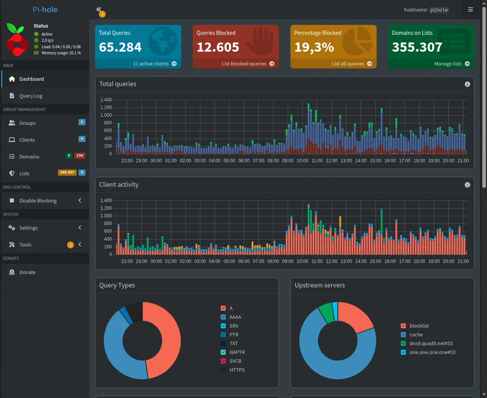

O painel do [CasaOS](https://github.com/IceWhaleTech/CasaOS) (que instala e gerencia apps em contêineres Docker) diz que o meu homelab está em 6% de CPU, 21% de RAM e 5,5 W, a 49 °C. É um Mac mini de 2018 rodando Ubuntu 26.04, ligado por cabo no modem da operadora, e é nele que moram o DNS da casa, a minha biblioteca de música, os backups do notebook e a homologação deste site.

A grade de ícones é a parte que todo mundo mostra (e eu também, olha a capa aí). Só que instalar um app no CasaOS é um clique, e não foi o clique que me custou tempo. O que custou foi decidir em qual disco cada coisa mora, como cada aparelho da casa encontra o servidor e como eu chego nele quando estou fora.

Comprei esse Mac mini em outubro de 2020 e ele foi o meu computador principal por uns dois anos. Depois virou o computador secundário por mais alguns anos, até ficar legado de vez: as atualizações do macOS deixaram o uso inviável. Foi aí que, em 2025, decidi transformar ele no meu homelab pessoal.

Sigo o canal do Diolinux há muitos anos (desde 2012, mais ou menos), então a ideia de ter um servidor em casa já rondava faz tempo. Se você nunca ouviu falar em homelab, o vídeo dele [Como começar no Homelab do Zero? Guia para Iniciantes](https://www.youtube.com/watch?v=MUHk0PKn2TQ) explica o que é e por onde começar melhor do que eu explicaria aqui.

## O SSD guarda o estado, o HD guarda o volume

O Mac mini tem um SSD interno de 232 GB em btrfs. Fica nele tudo que precisa ser rápido e estável: o sistema, os containers e o `/DATA/AppData`, onde estão as configurações e os bancos de cada app. O volume (filmes, música, fotos, documentos) vai pra um HD de 1 TB de 5400 rpm pendurado na USB.

Os apps nem ficam sabendo. O CasaOS espera tudo em `/DATA`, então `/DATA/Media`, `/DATA/Gallery`, `/DATA/Documents`, `/DATA/Downloads` e `/DATA/Notas` são bind mounts pras pastas do HD, uma linha de `fstab` pra cada:

```
/mnt/HD-1TB/DATA/Media  /DATA/Media  none  bind,nofail,x-systemd.requires=/mnt/HD-1TB  0 0
```

**As duas opções do fim são o que faz isso sobreviver a um reboot.** O `x-systemd.requires` garante que o HD monta antes do bind, e o `nofail` impede que um HD desconectado segure o boot inteiro de uma máquina que não tem monitor.

Fiz essa mudança em junho, quando o SSD bateu 77%: `rsync -aHAX`, conferência de contagem de arquivos e tamanho, a pasta antiga renomeada pra `.old` como caminho de volta, o bind no lugar e só então a remoção. Liberou uns 48 GB. Os outros dois discos da capa são um HD de 500 GB de 2012, com setores defeituosos e no fim da vida, e o pendrive de 64 GB com as ROMs do fliperama (já chego nele).

## A casa chega por cabo, eu chego pelo Tailscale

A rede é simples: o modem da operadora no centro, o homelab num cabo e os roteadores mesh em modo ponto de acesso, então tudo vive na mesma rede.

Pra entrar no servidor eu uso o [Tailscale](https://tailscale.com) (uma VPN que liga os meus aparelhos numa rede privada, a tailnet, de onde eu estiver), até dentro de casa. O meu `ssh homelab` aponta pro IP da tailnet, e não pro da rede local, porque as chaves do meu ssh-agent pararam de autenticar no IP local (todas davam `Permission denied (publickey)` até o agente estourar em "Too many authentication failures"). O Tailscale SSH autentica pela identidade da tailnet e o problema simplesmente sumiu:

```
Host homelab
    HostName <IP do homelab na tailnet>
    User nandomoreira
```

Os serviços ganham nomes `.home`, com o [Caddy](https://caddyserver.com) na frente fazendo o proxy reverso (ele recebe cada endereço e repassa pro app certo):

```
http://media.home {
    reverse_proxy localhost:8096
}
```

O [Pi-hole](https://pi-hole.net) resolve os `.home` pro IP do homelab na tailnet, e o DNS do Tailscale manda as consultas de `home` pra ele. O resultado é que `media.home` abre o [Jellyfin](https://jellyfin.org) no celular de qualquer lugar, desde que o aparelho esteja na minha tailnet, e não abre em mais lugar nenhum.

O Pi-hole também é o nameserver global da tailnet, com o DNS local sobrescrito: todo aparelho meu ganha bloqueio de anúncio até fora de casa. O preço é que, se o homelab cair, os aparelhos remotos ficam sem DNS até eu tirar essa configuração no painel do Tailscale. (Cheguei nisso por causa de um bug, que conto mais abaixo.)

A exceção é o atalho do teclado que liga o modo solo do Red Dead Online. O Tailscale SSH às vezes pede uma reautenticação no navegador, e um atalho não tem terminal nem navegador pra isso, então ele fala com a API web do [rdo-solo](/rdo-solo-red-dead-online-sozinho-pelo-gateway) pela rede local.

## O Pi-hole é quem mais trabalha aqui

De tudo que roda no homelab, o Pi-hole é o que mais salva a minha rede. Ele é o DNS da casa: cada aparelho pergunta a ele onde fica um site, e o que está na lista de bloqueio recebe `0.0.0.0` de resposta e simplesmente não carrega. Nas 24 horas até 17 de outubro foram 65.284 consultas de 11 aparelhos, e 12.605 delas (19,3%) bateram num bloqueio. **Uma em cada cinco consultas da casa era anúncio, rastreador ou coisa pior.**



São 355 mil domínios em três listas: a StevenBlack (anúncio e malware), a hagezi Multi PRO (anúncio, rastreamento e telemetria) e a hagezi de nsfw (~~pornografia~~ conteúdo adulto, vamos manter o nível). Por cima delas tem 138 regras minhas, em regex, que fui juntando com o tempo. Vinte e nove são de casas de aposta, Betano, Betfair e Betway, cada uma com o domínio de vários países, porque bloquear só o `.com` não adianta nada. O resto pega sites como o 9gag e o Bilibili. Ele ainda força o SafeSearch do Google, do Bing, do DuckDuckGo e do YouTube por CNAME, por causa das crianças aqui de casa.

A lista Multi PRO bloqueia a telemetria da TV LG, mas poupa de propósito os endpoints que o app ThinQ usa pra controlar a TV. Bloquear esses derruba o controle da TV pelo celular.

O painel fica em `pihole.home`, com o Caddy redirecionando a raiz direto pro `/admin`. É a aba que eu mais abro no homelab, e foi olhando pra ela que descobri que, por meses, o Pi-hole filtrou quase ninguém.

### O DNS que achava que servia a casa toda

Em junho os Decos ainda faziam NAT da rede da casa, e o Pi-hole via todo mundo como um cliente só, o IP do Deco, com 167 mil consultas. Quando passei os Decos pra ponto de acesso, configurei o DNS do Pi-hole no app do Deco e dei o assunto por encerrado. Só que um Deco em modo AP não tem DHCP nem DNS próprios: quem entrega DNS pra casa é o modem da operadora. A TV, o Fire TV e os celulares continuaram indo direto no DNS da operadora, e o Pi-hole ficou servindo os containers do próprio homelab e um notebook, sem ninguém perceber.

A correção foi no lugar certo, o DHCP do modem, apontando o DNS pro homelab. O Pi-hole foi de 4 para 15 clientes, conforme cada aparelho renovava o lease.

Duas coisas que aprendi nessa:

- Nada de DNS público no secundário. O cliente alterna entre primário e secundário quando quer, então metade das consultas escapa do filtro e o Pi-hole parece meio quebrado sem motivo.
- Resposta vazia no `dig` não quer dizer bloqueado. Um domínio pode não ter registro A, e o Pi-hole em modo NULL responde `0.0.0.0`, que passa por qualquer teste ingênuo de "tem IP, então está liberado". O teste que funciona compara com um resolvedor externo e descarta o `0.0.0.0` na mão.

## Para que ele serve no meu dia

### A homologação do site

O `scripts/deploy-staging.sh` deste blog sincroniza a pasta de trabalho com o homelab por `rsync` (rascunhos incluídos), sobe o container com `docker compose`, garante a entrada no Caddy e no Pi-hole e testa por HTTP de lá e daqui. A prova é a última linha, `STAGING DEPLOY PASSED`, e não o exit code. Eu reviso os rascunhos em `nandomoreira.home`, no celular ou no iPad.

### O destino dos backups

O notebook manda um snapshot btrfs do sistema todo dia ao meio-dia, por `btrfs send` incremental (o primeiro, completo, tem uns 26 GiB). Outro job manda por `restic` uma pasta de trabalho de 35 GiB, em boa parte fora do git: o primeiro backup ocupou 5,3 GiB no repositório, entre deduplicação e compressão, e a senha do repositório mora no 1Password, porque sem ela o backup não serve pra nada. O homelab também faz backup de si mesmo, com `restic` num container às 4h, das configurações, dos bancos e dos documentos. Filmes e fotos ficam de fora: estão no mesmo HD do repositório e dá pra baixar de novo. O repositório fica num disco diferente do SSD, mas na mesma máquina.

### A música

O Jellyfin transcodifica pela Intel UHD 630 do Mac mini (QuickSync) e tinha 3.610 faixas em 276 álbuns quando montei; o [Swing Music](https://github.com/swingmx/swingmusic) lê a mesma pasta. Pra importar um álbum eu uso uma skill do Claude Code que lê as tags e a capa, passa o `clamscan`, copia por `rsync` pelo Tailscale e só apaga a origem se o MD5 bater dos dois lados. A leitura das tags vem primeiro porque o Swing junta numa faixa só as músicas com título, álbum e artista iguais, e um álbum com títulos repetidos na tag aparece com uma faixa só.

### O fliperama

O fliperama fica na sala, com jogos retrô. Comprei dois controles parecidos com os do Super Nintendo, e é com eles que a gente joga junto aqui em casa (melhor uso de um Mac mini aposentado, sem discussão). Por baixo, um usuário `arcade` sobe o [RetroArch](https://www.retroarch.com) direto na TV, num `cage` em `tty1`, com as ROMs no pendrive. O cursor do mouse ficou parado no meio da TV até eu descobrir que essa versão do `cage` ignora o `XCURSOR_THEME` e carrega o tema chamado `default` do sistema. A correção foi deixar o tema `default` transparente, depois de três tentativas mexendo no lugar errado.

### O Xbox

O homelab é o gateway do console pro [modo solo do Red Dead Online](/rdo-solo-red-dead-online-sozinho-pelo-gateway) e manda só o tráfego do Xbox por uma VPN, por roteamento por origem, pro IP de casa não aparecer nas sessões. O que aprendi olhando esse tráfego está no [estudo sobre as sessões do jogo](/sessoes-do-red-dead-online-p2p-relays-e-nat-duplo).

## O que quebrou

### Nove dias de backup que não salvou nada útil

O script que escolhe o snapshot base do envio incremental chamava `ssh` dentro de um `while read`. O `ssh` consumia a entrada do loop, o script só testava o candidato mais recente, e todo envio virava completo: 48 GiB que morriam no `TimeoutStartSec` de duas horas do serviço. Como o envio nunca terminava, a limpeza local também não rodava, e 12 snapshots se acumularam no notebook. A correção foi um `ssh -n` nas checagens, com sete testes em [bats](https://github.com/bats-core/bats-core) pra isso não voltar.

### O Nextcloud comeu o SSD

Em agosto o SSD estava em 94%. O diretório de dados do [Nextcloud](https://nextcloud.com) tinha 97,9 GB com a pasta de arquivos vazia: 79 GB eram lixeira e 18,9 GB eram versões antigas. Os meus arquivos ficavam no HD, montados como armazenamento externo, e ao apagar um arquivo de lá o Nextcloud copia ele pra lixeira dentro do diretório de dados, que estava no SSD. Sem retenção configurada, essa lixeira praticamente nunca expira. Somando os 75 GB de snapshots do bug anterior, deu o disco cheio.

Desliguei o Nextcloud de vez. Antes, resgatei os 14 GB de arquivos reais que estavam na lixeira, entre eles o "Live At The Rainbow" do Bob Marley em 24 bit/96 kHz, que não tinha cópia em lugar nenhum (quase foi embora por causa de uma lixeira). Com o journald limitado a 500 MB e as imagens Docker paradas removidas, o SSD foi de 94% para 33%: 142 GB de volta.

### O `docker pull` da tag que existia

Um dia toda instalação nova no CasaOS parava em "0% + Error response from daemon", e o erro do Docker dizia que não conseguia resolver a imagem. Parecia tag errada; era DNS. O `resolv.conf` do homelab aponta pro MagicDNS do Tailscale, que estava sem servidor de saída pra nomes públicos e respondia SERVFAIL pra tudo fora da tailnet. O Pi-hole local resolvia normalmente. A correção foi pôr o Pi-hole como nameserver global da tailnet, que é a configuração que descrevi lá em cima.

## O que ficou decidido

- O CasaOS é a vitrine e a loja de apps. A configuração de verdade está nos `docker-compose.yml`, no `Caddyfile` e no `fstab`, e eu edito pelo terminal: o editor visual do CasaOS mostra volume nomeado como `[object Object]`, e salvar por ali grava esse texto como caminho e quebra o compose.
- Os nomes `.home` só existem dentro da tailnet.
- O SSD guarda o estado; o HD guarda o que dá pra baixar ou copiar de novo.

`Connection to homelab closed.`
