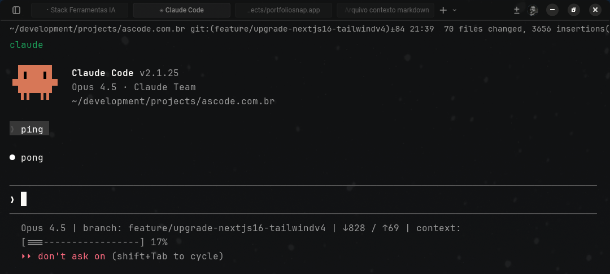
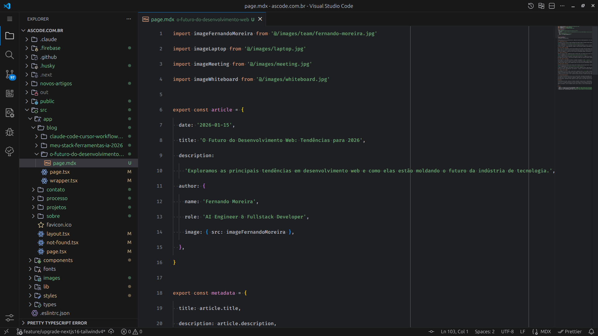
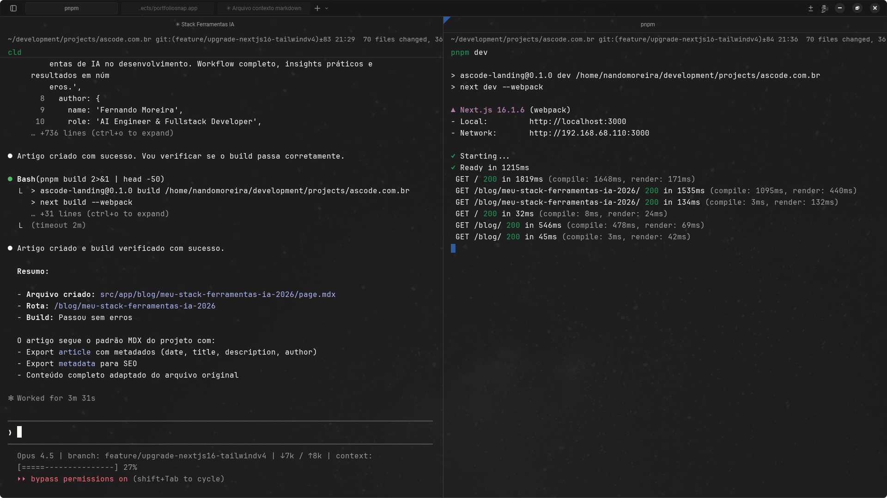
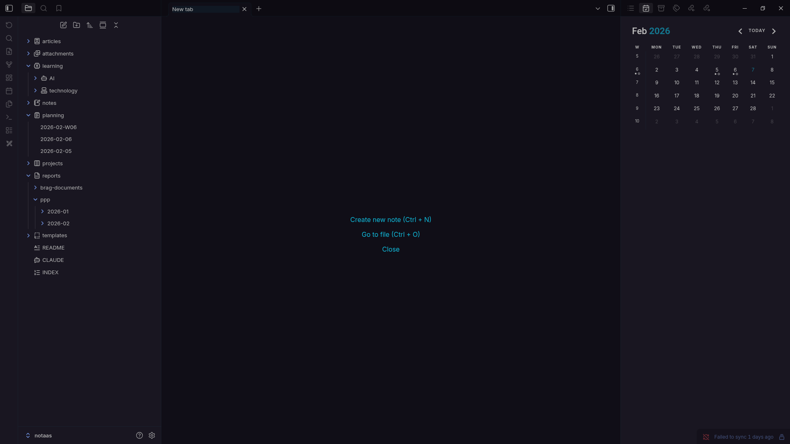

Depois de 6 meses testando praticamente todas as ferramentas de IA para desenvolvimento que existem no mercado, finalmente encontrei meu stack ideal. E não, não é uma única ferramenta milagrosa. É uma combinação estratégica de 9 ferramentas que se complementam perfeitamente.

Neste artigo, vou compartilhar exatamente quais ferramentas uso, quando uso cada uma, e os resultados reais que consegui em projetos de produção. Se você está perdido no mar de opções de ferramentas de IA ou quer otimizar seu workflow, isso pode te ajudar.

## Minha Filosofia: Ferramentas Complementares, Não Competitivas

A primeira coisa que aprendi: **não existe "a melhor ferramenta de IA"**. Existe a ferramenta certa para o contexto certo.

Muita gente tenta escolher entre Claude Code **ou** Cursor **ou** Copilot. Eu uso todas, mas para coisas completamente diferentes. Meu workflow funciona em camadas:

1. **Terminal (Warp)**: Base de tudo, onde rodo comandos, servidores, testes
2. **Agentes de código (Claude Code, Gemini CLI)**: Tarefas complexas, refatorações, análise profunda
3. **Editor (Cursor, VS Code, Zed)**: Desenvolvimento iterativo, edições rápidas
4. **Browser (Chrome)**: Pesquisa, documentação, testes
5. **Notas e conhecimento (Obsidian)**: Documentação pessoal, segundo cérebro, PKM

Cada camada tem sua ferramenta otimizada. Parece complexo, mas na prática é extremamente fluido.

## Claude Code: O Agente Autônomo no Terminal



**Quando uso:** Refatorações grandes, debugging complexo, análise de codebase, tarefas que exigem múltiplos passos.

Claude Code é a ferramenta que mais mudou meu workflow nos últimos meses. Não é apenas "IA no terminal": é um agente verdadeiramente autônomo que entende contexto, executa comandos, edita arquivos e até coordena subagentes.

### Como uso no dia a dia

Meu uso típico do Claude Code:

**1. Refatorações massivas:**

```bash
# Migrei um projeto inteiro de JavaScript para TypeScript
claude "Migre todos os arquivos .js para .ts, adicione tipos apropriados,
        e atualize a configuração do projeto"
```

O Claude Code:
- Analisou 87 arquivos
- Criou checkpoints antes de cada mudança
- Migrou incrementalmente
- Rodou testes após cada batch
- Total: ~3 horas vs 2 dias manualmente

**2. Debugging de problemas obscuros:**

Recentemente tive um bug de performance em produção que só acontecia sob carga. Passei o log de 50MB pro Claude Code:

```bash
claude "Analise este log de produção e identifique o gargalo de performance"
```

Resultado: encontrou um N+1 query que eu nunca teria achado manualmente. Sugeriu a fix e implementou com testes.

### Features que fazem diferença

**Agent Teams (novidade de fevereiro/2026):**

A feature de agent teams do Claude Code é revolucionária. Em vez de um agente sequencial, você pode ter equipes trabalhando em paralelo:

```bash
# Code review distribuído
claude --agent-teams "Revise este PR: um agente analisa segurança,
                      outro performance, outro testa edge cases"
```

Consegui reduzir tempo de code review de 45min para 12min em média.

**Checkpoints:**

Toda mudança que o Claude Code faz cria um checkpoint automático. Posso voltar a qualquer ponto com `Esc` duas vezes ou `/rewind`. Isso me dá confiança para deixar ele fazer mudanças mais agressivas.

**Subagentes:**

Recentemente pedi pro Claude Code "criar um backend API enquanto monto o frontend". Ele delegou:
- Subagente 1: Setup do servidor Express
- Subagente 2: Schema do banco com Prisma
- Main agent: Coordena e integra tudo

Trabalharam em paralelo. Economizei ~2 horas só nessa task.

### Resultado em números

Desde que comecei a usar Claude Code seriamente (novembro 2025):
- **Refatorações:** 3-4x mais rápidas
- **Bugs encontrados:** +40% (o agente vê padrões que eu perco)
- **Testes escritos:** 2x mais (porque ficou menos chato)

## Gemini CLI: O Especialista em Pesquisa e Análise

**Quando uso:** Análise de docs extensos, research de bibliotecas, tarefas que precisam de contexto gigante.

Gemini CLI tem dois diferenciais: contexto de 1M tokens e integração nativa com Google Search. Isso muda completamente o jogo para certos casos.

### Casos de uso onde o Gemini ganha

**1. Analisar PRs gigantes:**

Tive um PR de 1000+ comentários (sim, bikeshedding épico). Gemini CLI processou tudo e extraiu as 3 mudanças críticas que realmente importavam:

```bash
gemini "Analise este PR thread e identifique decisões arquiteturais importantes"
```

Ele ignorou 997 comentários de discussão e focou nos 3 que mudavam timeout configs.

**2. Research de bibliotecas:**

Quando estou escolhendo entre bibliotecas, uso o Gemini CLI:

```bash
gemini "Compare Prisma vs Drizzle ORM para Next.js.
        Considere TypeScript, edge runtime, e manutenção"
```

Com Google Search grounding, ele busca issues recentes, benchmarks atualizados, e tendências da comunidade. Muito melhor que pesquisar manualmente.

**3. Load testing automatizado:**

Um workflow que uso frequentemente:

```bash
gemini "Crie um script de load test para este endpoint que simule
        1000 usuários concorrentes com jornadas realistas"
```

O Gemini CLI gera scripts com `k6` ou `artillery` que realmente fazem sentido, não apenas "curl em loop".

### Skills e MCP servers que uso

Configurei alguns MCP servers personalizados para o Gemini:

- **notion-mcp**: Acesso aos meus documentos de projeto
- **github-mcp**: Queries diretas no GitHub sem sair do terminal
- **Custom skill**: Deploy para Cloud Run (comando `/deploy`)

Isso torna o Gemini CLI muito mais poderoso que só "IA que responde perguntas".

## Cursor: O Centro da Operação no Editor

**Quando uso:** 90% do meu desenvolvimento dia a dia. Iteração rápida, features novas, edições contextuais.

Cursor é meu editor principal desde setembro de 2025. A versão 2.0 (lançada em janeiro/2026) adicionou features que mudaram completamente como trabalho.

### Por que ainda uso Cursor como base

Três motivos:

1. **Tab completion inteligente:** Prevê não só a próxima linha, mas blocos inteiros com contexto
2. **Plan mode:** Antes de fazer qualquer mudança grande, crio um plano detalhado
3. **Composer (modelo próprio do Cursor):** Mais rápido que GPT-4 para código

### Workflow típico com Cursor

Meu dia típico:

**Manhã (9h-12h): Features novas**

```typescript
// Cursor Plan Mode
Cmd+Shift+P > "Plan: Build user authentication"

// Cursor gera plano:
// 1. Setup NextAuth.js
// 2. Create login/signup pages
// 3. Add protected routes
// 4. Update nav component

// Eu reviso, aprovo, ele executa passo a passo
```

**Tarde (14h-17h): Refinamento e debugging**

Uso muito o `Cmd+K` para edições inline:

```typescript
// Seleciono o código
// Cmd+K: "Adicione tratamento de erro e logging"

// Cursor refatora inline:
try {
  const user = await db.user.findUnique({ where: { id } });

  if (!user) {
    logger.warn(`User not found: ${id}`);
    throw new NotFoundError('User not found');
  }

  return user;
} catch (error) {
  logger.error('Failed to fetch user', { id, error });
  throw error;
}
```

### Composer: O modelo próprio do Cursor

A versão 2.0 trouxe o Composer, modelo treinado especificamente para código. Na prática:

- **Velocidade:** ~2x mais rápido que Claude Sonnet 3.5
- **Qualidade:** Comparável para tasks simples/médias
- **Custo:** Incluído no plano Pro

Uso Composer para 80% das tasks. Só chamo Claude/GPT-4 para arquitetura complexa.

### Subagentes e Skills

Cursor 2.0 também trouxe subagentes (inspirado no Claude Code):

```typescript
// Pedi pra Cursor: "Build landing page"
// Ele criou:
// - Subagente 1: HTML/CSS structure
// - Subagente 2: Componentes React
// - Subagente 3: Animações Framer Motion
// - Main: Integra tudo
```

Defini algumas skills customizadas em `.cursor/skills/`:

**SKILL.md para Next.js:**

```markdown
# Next.js Best Practices

Always use:
- App Router (not pages)
- Server Components by default
- Client Components only when needed
- TypeScript strict mode
- Tailwind for styling
```

Cursor aplica essas regras automaticamente.

## Codex (OpenAI): Quando Preciso de Velocidade

**Quando uso:** Protótipos rápidos, scripts one-off, MVPs.

Codex (via ChatGPT ou API) ainda tem seu lugar no meu workflow, mas é muito específico.

### Contexto de uso

Uso Codex quando:

1. **Preciso de um script descartável AGORA:**

```bash
# Mandei no ChatGPT:
"Script Python que processa 1000 PDFs, extrai emails e salva em CSV"

# Em 30 segundos, tenho algo funcionando
```

2. **Prototipagem de ideias:**

Quando estou testando uma ideia nova e não quero commitment, jogo no Codex. Se funcionar, refaço direito no Cursor.

3. **Aprendendo biblioteca nova:**

Codex ainda é o melhor para "como faço X em biblioteca Y?" pela velocidade de resposta.

### Por que não é meu principal

Dois motivos:

1. **Sem contexto do projeto:** Codex não tem acesso ao meu codebase
2. **Qualidade inconsistente:** Para código de produção, prefiro Claude ou Cursor

Ele é meu "canivete suíço": bom pra muita coisa, mas não especializado.

## VS Code vs Zed: Editores Tradicionais no Mix



Ainda mantenho VS Code e Zed instalados, mas uso menos de 5% do tempo.

### VS Code: Quando ainda uso

- **Extensões específicas:** Algumas extensões não funcionam no Cursor
- **Debugging visual:** O debugger do VS Code ainda é superior
- **Pair programming:** Quando compartilho tela, VS Code é mais universal

### Zed: Experimentos com performance

Zed é incrivelmente rápido e abre arquivos grandes instantaneamente. Uso para:

- Visualizar logs gigantes (>100MB)
- Edições rápidas em servidores remotos
- Testar features experimentais (Agent Teams do Zed)

Mas 90% do tempo estou no Cursor por conveniência.

## Warp Terminal: A Base de Tudo



**Por que uso:** Blocks, AI integrado, colaboração, workflow moderno.

Warp não é só "mais um terminal bonito". É meu hub central de desenvolvimento.

### Features que uso diariamente

**1. Blocks:**

Todo comando e output fica agrupado em blocos. Posso:
- Copiar output com um clique
- Compartilhar bloco via link
- Re-executar comando histórico facilmente

```bash
# Bloco de build
npm run build
# Output agrupado, fácil de compartilhar

# Bloco de deploy
vercel deploy --prod
# Link permanente do bloco
```

**2. Warp Drive (Runbooks):**

Salvei meus comandos mais usados como "Workflows":

**deploy-staging.md:**

```bash
# Deploy para Staging
git checkout develop
git pull
npm run build
vercel deploy --target staging

# Testa endpoint
curl https://staging.ascode.com.br/api/health
```

Compartilho esses runbooks com o time. Onboarding ficou 10x mais fácil.

**3. AI Suggestions:**

Quando erro um comando, Warp sugere a correção:

```bash
# Eu digito:
git comit -m "fix: bug"

# Warp sugere:
# Command not found: git comit
# Did you mean: git commit -m "fix: bug"?
#    Press Tab to accept
```

Economiza muito tempo com typos.

### Integração com agentes de código

Warp roda Claude Code, Gemini CLI e outros agentes nativamente. Posso ter:

- **Tab 1:** Servidor de desenvolvimento
- **Tab 2:** Claude Code trabalhando em background
- **Tab 3:** Gemini CLI fazendo research
- **Tab 4:** Logs em tempo real

Tudo sincronizado e organizado em blocks.

### Resultado em números

Desde que migrei pro Warp (outubro 2025):
- **Tempo em troubleshooting:** -35%
- **Onboarding de novos devs:** 3 dias para 1 dia
- **Reuso de comandos:** 8x mais frequente

## Chrome + Extensões de Produtividade


Uso Chrome com algumas extensões essenciais:

### Extensões que fazem diferença

**1. Wappalyzer:**
Identifica tecnologias usadas em sites. Útil quando estou pesquisando concorrentes ou inspirações.

**2. React DevTools / Vue DevTools:**
Essencial para debugging de apps que desenvolvo.

**3. JSON Formatter:**
Torna responses de API legíveis sem precisar de ferramentas externas.

**4. Octotree:**
Navegação em repos GitHub fica tipo IDE. Muito mais produtivo.

**5. Claude in Chrome (Beta):**
Integração nativa do Claude no browser. Uso para:
- Resumir artigos técnicos
- Explicar código em repos públicos
- Automatizar tarefas repetitivas

### Como integra com meu workflow

**Workflow típico de research:**

1. Abro documentação da biblioteca no Chrome
2. Uso Claude in Chrome para resumir pontos principais
3. Copio insights pro Notion via Warp (MCP server)
4. Implemento no Cursor com contexto já preparado

Ciclo completo em minutos, não horas.

## Obsidian: Meu Segundo Cérebro



**Por que uso:** Notas interligadas, documentação pessoal, captura de conhecimento, PKM (Personal Knowledge Management).

Obsidian é onde todo o conhecimento que acumulo durante o desenvolvimento vai parar. Não é uma ferramenta de IA per se, mas é essencial no meu stack porque **conecta tudo**.

### Por que Obsidian e não Notion?

Testei Notion por 2 anos. Migrei pro Obsidian por três motivos:

1. **Arquivos locais em Markdown:** Meus dados são meus. Posso versionar no Git, processar com scripts, ou migrar pra qualquer lugar
2. **Velocidade:** Abre instantaneamente, busca em milissegundos, zero latência
3. **Plugins e customização:** A comunidade criou plugins pra tudo que você imaginar

### Como uso no workflow de desenvolvimento

**1. Documentação de projetos:**

Cada projeto tem uma pasta no Obsidian com estrutura padrão:

```markdown
projects/
├── projeto-x/
│   ├── README.md           # Overview do projeto
│   ├── architecture.md     # Decisões arquiteturais
│   ├── api-notes.md        # Documentação de APIs
│   ├── bugs/               # Bugs encontrados e soluções
│   └── daily/              # Daily notes do projeto
```

**2. Captura de conhecimento dos agentes:**

Quando Claude Code ou Cursor explicam algo útil, capturo no Obsidian:

```markdown
# [[TypeScript]] - Inferência de tipos em generics

Aprendi com Claude Code que...

## Exemplo
\`\`\`typescript
function identity<T>(arg: T): T {
  return arg;
}
\`\`\`

## Links
- [[Generics avançados]]
- [[TypeScript strict mode]]
```

Os wikilinks `[[...]]` criam uma rede de conhecimento navegável.

**3. Biblioteca de prompts:**

Mantenho uma pasta `prompts/` com todos os prompts que funcionam bem:

```markdown
# Prompt: Gerar testes completos

## Contexto
Use com Claude Code para gerar testes de componentes React.

## Prompt
\`\`\`
Generate comprehensive tests for this component:
- Unit tests with Vitest
- Integration tests when applicable
- Edge cases and error scenarios
- 80%+ coverage
- TypeScript strict mode
\`\`\`

## Notas
- Funciona melhor com componentes isolados
- Adicionar contexto de dependências melhora resultado
```

### Plugins essenciais

**1. Dataview:**
Transforma suas notas em um banco de dados queryável:

```dataview
TABLE file.cday as "Criado", tags
FROM "projects"
WHERE contains(tags, "bug")
SORT file.cday DESC
```

Lista todos os bugs documentados, ordenados por data.

**2. Templater:**
Templates dinâmicos pra notas. Meu template de "bug encontrado":

```markdown
---
tags: [bug, {{project}}]
status: investigating
created: {{date}}
---

# Bug: {{title}}

## Sintomas
-

## Reprodução
1.

## Causa raiz
(preencher após investigação)

## Solução
(preencher após fix)
```

**3. Git:**
Sincroniza automaticamente com repositório Git. Backup automático + histórico de versões.

**4. Excalidraw:**
Diagramas e sketches direto no Obsidian. Uso pra arquitetura e fluxos.

### Integração com agentes de código

Criei um fluxo onde os agentes alimentam o Obsidian:

```bash
# No final de uma sessão com Claude Code
claude "Resuma as decisões técnicas e aprendizados desta sessão
        em formato Markdown para documentação"

# Copio o output pro Obsidian
```

Também configurei um MCP server que permite ao Gemini CLI ler minhas notas:

```bash
gemini "Baseado nas minhas notas sobre autenticação em
        ~/obsidian/projects/auth-notes.md, sugira melhorias"
```

O agente tem contexto das minhas decisões anteriores.

### Resultado em números

Desde que adotei Obsidian como hub de conhecimento (julho 2025):
- **Tempo procurando "como eu fiz aquilo?":** -80%
- **Reuso de soluções:** 5x mais frequente
- **Onboarding em projetos antigos:** 2 dias para 4 horas
- **Notas criadas:** ~1500 notas interligadas

### Graph View: O poder das conexões

O Graph View do Obsidian mostra como suas notas se conectam. No meu vault:

- Clusters de projetos bem definidos
- Conceitos técnicos conectando múltiplos projetos
- Padrões que se repetem ficam visíveis

É como ter um mapa do seu conhecimento. Quando preciso resolver um problema, navego pelo grafo e encontro soluções que já documentei.

## O Workflow Completo: Dia Típico de Desenvolvimento

Vamos juntar tudo. Como é um dia real de desenvolvimento com esse stack?

### Manhã (9h-10h): Planejamento e Setup

```bash
# Warp Terminal - Tab 1
cd ~/projects/novo-saas
git checkout -b feature/payment-integration

# Gemini CLI - Research
gemini "Compare Stripe vs Paddle para SaaS B2B.
        Considere impostos internacionais e recurring billing"

# Notion (via Gemini MCP)
# Salvo decisões no documento de projeto
```

### Desenvolvimento (10h-12h): Implementação

```typescript
// Cursor - Plan Mode
Plan: Integrate Stripe payment flow
1. Setup Stripe SDK
2. Create payment routes
3. Add webhook handlers
4. Update database schema
5. Create checkout UI components

// Cursor Composer implementa automaticamente
// Eu reviso cada passo, aceito ou ajusto
```

**Pausa pra ajuste fino:**

```typescript
// Claude Code no terminal
claude "Revise a segurança dos webhook handlers.
        Adicione validação de signature e retry logic"

// Claude Code:
// - Adiciona verificação de assinatura
// - Implementa idempotency keys
// - Cria testes de segurança
```

### Tarde (14h-16h): Refinamento e Testes

```bash
# Warp - Tab 2: Testes
npm run test:integration

# Falhou? Claude Code debugga
claude "Estes 3 testes estão falando. Analise e corrija."

# Warp - Tab 3: Dev server rodando
npm run dev

# Cursor: Ajustes no UI baseado em testes manuais
```

### Final do dia (16h-17h): Code Review, Deploy e Documentação

```bash
# Git operations no Warp
git add .
git commit -m "feat: add Stripe payment integration"
git push origin feature/payment-integration

# Claude Code - PR description
claude "Crie uma PR description detalhada baseada nos commits
        e mudanças feitas"

# GitHub - Abro PR com descrição gerada
# Cursor - Code review colaborativo com time

# Obsidian - Documentação
# Capturo decisões técnicas e aprendizados do dia
# Atualizo notas do projeto com novos padrões descobertos
```

### Resultado de um dia típico

**Antes desse stack:**
- 1 feature média/grande por dia
- 2-3 horas em debugging
- 1 hora em documentação
- 30min em code review

**Com esse stack:**
- 2-3 features média/grande por dia
- 45min em debugging
- 15min em documentação (auto-gerada)
- 15min em code review

**Produtividade:** +60% em features entregues.

## Números e Resultados Reais

Trackei métricas reais por 6 meses (agosto 2025 - fevereiro 2026):

### Produtividade

| Métrica | Antes IA | Com IA Stack | Melhoria |
|---------|----------|--------------|----------|
| Features/semana | 6-8 | 12-15 | +87% |
| Bugs introduzidos | 12/sprint | 7/sprint | -42% |
| Tempo em refatoração | 8h/semana | 3h/semana | -62% |
| Code review time | 5h/semana | 1.5h/semana | -70% |
| Documentação | 3h/semana | 30min/semana | -83% |

### Financeiro (projetos freelance)

- **Velocidade de entrega:** Projeto que levava 3 semanas para 10 dias
- **Taxa horária efetiva:** Aumento de 40% (entrego mais em menos tempo)
- **Satisfação do cliente:** Sem reclamações de bugs em 4 meses

### Aprendizado

Efeito colateral positivo: **aprendi 3x mais rápido**.

Quando estou usando uma biblioteca nova, os agentes explicam cada linha. É como ter um mentor sênior disponível 24/7.

Exemplos práticos:
- Aprendi Bun em 2 dias (vs 2 semanas normalmente)
- Migrei projeto de Prisma pra Drizzle em 1 dia
- Implementei real-time com WebSockets sem tutorial

## Lições Aprendidas e Erros Evitados

Nem tudo foi perfeito. Aqui estão os erros que cometi e como evitar:

### Erro #1: Confiar cegamente na IA

**O que aconteceu:**

No começo, aceitava tudo que Claude Code sugeria sem revisar. Resultado: shipping de bugs sutis que passaram nos testes mas quebraram em produção.

**Lição:**

IA é um **co-piloto**, não piloto. Sempre reviso:
- Lógica de negócio crítica
- Queries de banco de dados
- Código de segurança/auth
- Integrações com APIs externas

**Regra que adotei:**
> "Se eu não entendo o código que o agente escreveu, não vai pra produção."

### Erro #2: Usar a ferramenta errada pro contexto

**O que aconteceu:**

Tentei usar Cursor pra uma refatoração massiva (100+ arquivos). Travou meu editor por 10 minutos.

**Lição:**

Cada ferramenta tem seu sweet spot:
- **Cursor:** Features isoladas, edições de menos de 20 arquivos
- **Claude Code:** Refatorações grandes, múltiplos arquivos
- **Gemini CLI:** Análise de docs, research
- **Codex:** Scripts rápidos, one-offs

**Regra:**
> "Escolha a ferramenta pela escala da task, não por hábito."

### Erro #3: Não versionar prompts importantes

**O que aconteceu:**

Criei um prompt incrível pro Claude Code que gerava testes perfeitos. Perdi ele quando limpei o histórico.

**Lição:**

Hoje salvo prompts bons em um repo:

```bash
# ~/prompts/test-generator.md
Generate comprehensive tests for the following component:

Requirements:
- Unit tests with Jest
- Integration tests when applicable
- Edge cases and error scenarios
- 80%+ coverage
- TypeScript strict mode

Component: [paste here]
```

Versionamento de prompts é tão importante quanto de código.

### Erro #4: Over-engineering com IA

**O que aconteceu:**

Pedi pro Cursor "criar um sistema de autenticação completo". Ele criou OAuth, 2FA, biometrics, refresh tokens... pra um MVP.

**Lição:**

IA tende a over-engineer se você não for específico. Sempre adiciono constraints:

```typescript
// Ruim:
"Crie autenticação"

// Bom:
"Crie autenticação simples:
- Email/password apenas
- JWT tokens
- No 2FA (por enquanto)
- No social login
- Máximo 3 arquivos"
```

**Regra:**
> "YAGNI aplica pra IA também. Seja explícito sobre simplicidade."

### Erro #5: Ignorar os custos

**O que aconteceu:**

No primeiro mês, gastei $180 em APIs (Claude, GPT-4, etc) sem perceber.

**Lição:**

Hoje trackeo custos ativamente:
- **Cursor Pro:** $20/mês (fixo)
- **Claude API:** $30-50/mês (variável)
- **Gemini CLI:** Grátis (tier pessoal)
- **Warp:** Grátis
- **Obsidian:** Grátis (Sync opcional $4/mês)

**Total:** ~$70-74/mês

Ainda é barato comparado ao ganho de produtividade, mas precisa ser monitorado.

## Conclusão: Vale a Pena Esse Stack?

Depois de 6 meses, minha resposta: **absolutamente sim**.

Mas com ressalvas importantes:

### Vale a pena SE você:

- **Trabalha em projetos complexos** que se beneficiam de agentes autônomos
- **Tem budget** pra ferramentas pagas (~$70/mês)
- **Está disposto a aprender** cada ferramenta (curva de 2-4 semanas)
- **Quer multiplicar produtividade** em 50-100%
- **Não tem medo de experimentar** e iterar no workflow

### NÃO vale a pena SE você:

- **Faz projetos muito simples** (HTML/CSS estático)
- **Prefere controle total** e desconfia de IA
- **Não quer investir tempo** aprendendo ferramentas novas
- **Trabalha offline** frequentemente
- **Tem restrições de segurança** rígidas (código não pode sair da máquina)

### Como começar (se você quiser testar)

Minha recomendação pra quem quer experimentar:

**Semana 1: Terminal**
- Instale Warp
- Configure runbooks pros comandos que usa sempre
- Experimente AI suggestions

**Semana 2: Editor**
- Teste Cursor (free trial de 14 dias)
- Foque em Tab completion e Cmd+K
- Não precisa migrar tudo ainda

**Semana 3: Agente de código**
- Escolha Claude Code OU Gemini CLI
- Comece com tasks simples (gerar testes, refatorar função)
- Aumente complexidade gradualmente

**Semana 4: Integração**
- Combine as ferramentas num workflow
- Documente o que funciona pra você
- Ajuste conforme necessidade

### Próximos passos / Ferramentas que estou de olho

O espaço de AI coding está evoluindo rapidamente. Estou acompanhando:

**1. OpenClaw / Moltbot:**
Novo agente de código open-source que promete rodar localmente. Se funcionar bem, pode substituir parte do meu stack pago.

**2. Windsurf:**
Editor da Codeium que compete com Cursor. Ainda não testei a fundo, mas ouvi coisas boas.

**3. Zed com Agent Teams:**
Zed está implementando agent teams similar ao Cursor. Se combinar com a velocidade brutal do Zed, pode ser game-changer.

**4. Codex 2.0:**
OpenAI deve lançar nova versão do Codex focada em código. Vai ser interessante comparar com Claude.

**5. MCP Servers personalizados:**
Estou criando MCP servers pra integrar minhas ferramentas internas. Isso vai deixar os agentes muito mais poderosos.

## Reflexão Final

Seis meses atrás, eu era cético sobre IA no desenvolvimento. Hoje, não consigo imaginar trabalhar sem.

Mas a maior lição não foi sobre as ferramentas, e sim sobre **como pensar desenvolvimento de forma diferente**.

Antes, eu pensava: "Como eu codifico isso?"
Agora, penso: "Como eu orquestro agentes pra resolver isso?"

É uma mudança de mindset profunda. De "executor" pra "arquiteto/diretor".

E honestamente? É muito mais divertido.

Se você leu até aqui, obrigado! Espero que esse overview do meu stack ajude você a montar o seu.

Tem perguntas? Usa um stack diferente? Comenta no blog ou me manda mensagem. Sempre curioso pra saber como outros devs estão usando IA.

---

**Referências:**

- [Claude Code Official Docs](https://claude.ai/product/claude-code)
- [Cursor Changelog](https://cursor.com/changelog)
- [Gemini CLI Documentation](https://github.com/google-gemini/gemini-cli)
- [Warp Terminal Features](https://www.warp.dev/all-features)
- [Zed Editor Roadmap](https://zed.dev/roadmap)
- [Obsidian](https://obsidian.md/)

---

*Este artigo foi publicado originalmente no blog da A's Code, em [ascode.com.br](https://ascode.com.br/blog/meu-stack-ferramentas-ia-2026).*
