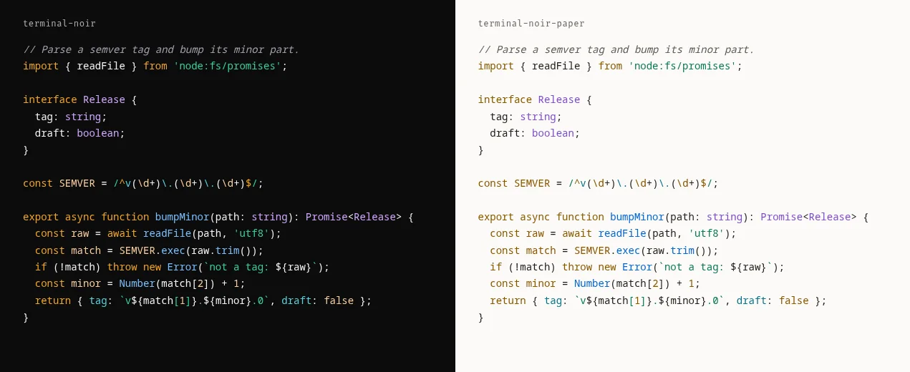
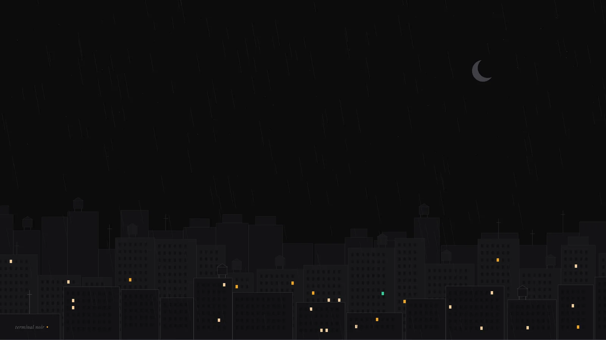
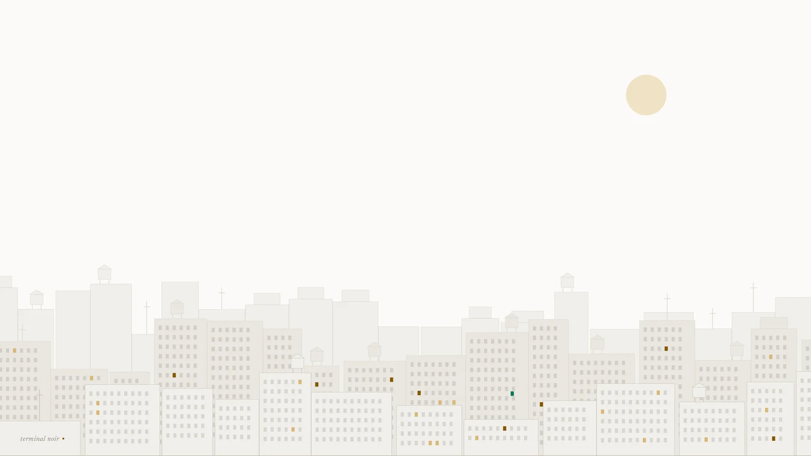

O Terminal Noir começou como a paleta do meu site e terminou como o tema do meu sistema inteiro. Primeiro a barra do Noctalia ganhou o âmbar `#F5A623` do meu site no workspace ativo, no indicador de layout e no anel do timer. Depois vieram a borda das janelas no niri, o Ghostty, o Chrome, e numa noite só o [Terminal Noir](https://github.com/nandomoreirame/terminalnoir) tinha repositório público, site próprio e uma release `v0.1.0-beta`.

Quando você leva a sério a ideia de que o seu sistema operacional pode ter a sua cara, uma paleta vira uma dúzia de arquivos de configuração, a dúzia de arquivos vira um gerador, e o gerador te obriga a medir coisas que você nunca mediria num screenshot. Se você usa Linux há tempo suficiente e já tentou deixar tudo da mesma cor, sabe do que eu tô falando.

## Cor combinando é coisa de quem usa Linux

Eu gosto muito de ter as cores combinando no setup. Isso é coisa de quem usa Linux há muitos anos, e depois de passar pelo [Omarchy](https://omarchy.org) e chegar no CachyOS ficou mais evidente: esses sistemas deixam você customizar tudo, e o tema é só mais uma das customizações. É muito comum ver `.dotfiles` de Arch Linux com [niri](https://github.com/YaLTeR/niri) ou Hyprland, com o [Noctalia](https://noctalia.dev) ou outra barra, e um tema que pinta todos os apps possíveis com a mesma paleta. Isso é incrível.

**Fazer o meu OS ficar com a minha cara é parte do motivo de eu usar Linux**, e eu sei que tem gente que acha isso perda de tempo (essa gente usa o tema padrão e é feliz, e tá tudo bem). E o tema eu já tinha: os tokens de design do meu site, que eu tinha acabado de redesenhar e chamado de Terminal Noir. Superfícies quase pretas e frias, que mudam só de luminosidade, um único acento âmbar e um verde-esmeralda pra status.

## Do Noctalia a doze apps numa noite

O Noctalia foi o primeiro porque era o que estava na minha frente. O Claude leu o [`global.css`](https://github.com/nandomoreirame/nandomoreira.dev/blob/main/src/styles/global.css) do site, mapeou cada token pro papel equivalente da barra (fundo, superfície elevada, texto, acento) e usou o tema claro do modo leitura dos posts como variante clara. O niri veio logo depois: a borda da janela ativa, que era o azul padrão `#7fc8ff`, virou âmbar.

Depois do niri, levantei onde mais o tema cabia, do mais barato pro mais trabalhoso. O mais barato era o próprio Noctalia: a versão 5 tem modelos que geram o tema de outros apps a partir da paleta ativa, e o GTK saiu de graça por ali. O resto foi arquivo por arquivo, e o tema chegou no Ghostty, VS Code, Cursor, bat, btop, fzf, Powerlevel10k, Obsidian e Chrome, tudo dentro do meu repositório de dotfiles.

Foi aí que bateu a ideia. O [Dracula](https://draculatheme.com) e o [Catppuccin](https://catppuccin.com) são exatamente isso: uma paleta e um monte de "ports", um por app. O nome estava livre (nenhum tema "Terminal Noir" publicado em editor, terminal ou qualquer outra ferramenta), e o que estava espalhado pelos meus dotfiles virou um projeto separado.

## Uma paleta, e o resto é gerado

A organização veio dos projetos que eu admiro. Tudo sai de dois arquivos: o [`palette/palette.json`](https://github.com/nandomoreirame/terminalnoir/blob/main/palette/palette.json), com as cores nomeadas por papel e não por valor, e o [`palette/syntax.json`](https://github.com/nandomoreirame/terminalnoir/blob/main/palette/syntax.json), com os papéis de sintaxe apontando pra nomes da paleta, nunca pra hex solto.

```json
"surface": { "base": "#0B0B0C", "raised": "#121214", "elevated": "#18181B" },
"text":    { "primary": "#F4F4F5", "muted": "#A1A1AA", "faint": "#6B6B74" },
"accent":  { "primary": "#F5A623", "success": "#34D399" }
```

Cada app ganhou um script em [`scripts/ports/`](https://github.com/nandomoreirame/terminalnoir/tree/main/scripts/ports) que lê a paleta com [jq](https://jqlang.org) e escreve o arquivo no formato que o app entende: um plist pro bat, um JSON de tema pro VS Code, um KDL pro niri, um manifest com cores em RGB pro Chrome. Mudar uma cor é editar um arquivo e rodar [`make build`](https://github.com/nandomoreirame/terminalnoir/blob/main/Makefile). E pra ninguém esquecer de rodar, os testes em [bats](https://github.com/bats-core/bats-core) ([`tests/build.bats`](https://github.com/nandomoreirame/terminalnoir/blob/main/tests/build.bats)) geram tudo de novo numa pasta temporária e reprovam se o que está commitado divergir do que a paleta produz.

Bash e jq foram escolha do próprio Claude, e eu achei legal seguir: um tema não precisa de runtime nenhum além do que já vem em qualquer Linux.

## O site, em vez de um README gigante

O site eu comecei pelo [Stitch](https://stitch.withgoogle.com), o gerador de interface do Google, com um prompt que pedia o melhor dos dois: do Dracula, o hero confiante e a grade de apps; do Catppuccin, a paleta como protagonista e o seletor de variante. O resultado ficou bom pra começar, só que grande demais, em largura e em seções, então segui direto no código com um site menor, de poucas páginas, como o do Catppuccin: Home, About, Ports, Palette e Docs.

O [terminalnoir.web.app](https://terminalnoir.web.app) é Astro estático e não tem um hex escrito à mão no CSS: no build ele lê a paleta, o registro de ports e o README de cada port. Saiu em inglês e português, e cada port ganhou uma página com o screenshot dele. O deploy vai pro Firebase Hosting a cada push na `main` (o GitHub Actions se autentica no Google Cloud sem chave guardada em lugar nenhum, por federação de identidade).

## O que eu não tinha medido: contraste

Quando fui planejar o modo claro do meu site usando a variante Paper do próprio Terminal Noir, antes de escrever uma linha, medi o contraste de cada cor contra cada superfície, pela fórmula do [WCAG 2.1](https://www.w3.org/TR/WCAG21/#contrast-minimum) (texto precisa de 4,5:1; borda que delimita algo clicável, de 3:1).

A Paper reprovava em 13 papéis. O Noir, em 2.

| Variante | Papel | Valor | Pior razão | Corrigido | Pior razão |
|---|---|---|---|---|---|
| Paper | ciano claro (ANSI) | `#3192AA` | 2,89 | `#0A7187` | 4,52 |
| Paper | magenta claro (ANSI) | `#A475F9` | 2,60 | `#7C4BCB` | 4,52 |
| Paper | azul claro (ANSI) | `#218BFF` | 2,72 | `#0666C5` | 4,54 |
| Paper | verde de status | `#047857` | 4,40 | `#0B7656` | 4,51 |
| Noir | contorno | `#3F3F46` | 1,70 | `#64646B` | 3,02 |
| Noir | preto claro (ANSI) | `#6B6B74` | 3,36 | `#808089` | 4,53 |

Os papéis de sintaxe apontam pra paleta, então o erro se espalhava: no editor claro, os tipos e as propriedades ficavam entre 2,6 e 3,5. Ninguém teria notado olhando os screenshots, porque quase todos são do tema escuro.

A correção virou parte do projeto. Escrevi a fórmula de contraste em jq ([`scripts/lib/contrast.jq`](https://github.com/nandomoreirame/terminalnoir/blob/main/scripts/lib/contrast.jq), a fórmula cabe em seis linhas) e um teste em bats ([`tests/contrast.bats`](https://github.com/nandomoreirame/terminalnoir/blob/main/tests/contrast.bats)) que mede todo papel legível nas três superfícies de cada variante e reprova o build se algum ficar abaixo do piso. Pra corrigir, cada cor manteve o matiz e mudou só a luminosidade, em passos pequenos no espaço [OKLCH](https://oklch.com), até o pior caso passar. Foram 15 cores, e todos os ports foram gerados de novo a partir delas.

Dois detalhes que só aparecem fazendo: no jq, um parâmetro chamado `$floor` esconde a função `floor` que você chama logo abaixo (o erro que aparece não tem nada a ver com isso); e o Chrome recusa um manifest com `0.1.0-beta` na versão, porque só aceita números. O rótulo completo foi pro campo `version_name` ([`scripts/ports/chrome.sh`](https://github.com/nandomoreirame/terminalnoir/blob/main/scripts/ports/chrome.sh)).

## Código no tema do código

Com a paleta corrigida, faltava uma coisa no meu site: os blocos de código usavam um tema do GitHub, que não tem nada a ver com a paleta. Então o Terminal Noir ganhou um port pro [Shiki](https://shiki.style), o realçador de sintaxe que o Astro usa: dois temas, [`terminal-noir`](https://github.com/nandomoreirame/terminalnoir/blob/main/ports/shiki/terminal-noir.json) e [`terminal-noir-paper`](https://github.com/nandomoreirame/terminalnoir/blob/main/ports/shiki/terminal-noir-paper.json), gerados do mesmo `syntax.json` e testados token por token.



Esse post já está nele. O botão no rodapé troca entre Noir e Paper, a primeira visita segue o tema do seu sistema, e os dois passam no mesmo teste de contraste.

## Uma cidade, duas variantes

Tema de desktop sem papel de parede fica pela metade, então pedi dois pro Stitch, um noir e um paper. Os primeiros usavam o cursor do terminal como motivo e não me convenceram. Pedi outro conceito, uma cidade noir, e a geração do Stitch simplesmente não voltou: deu timeout e nenhuma tela nova apareceu no projeto.

Aí coloquei os dois pra tentar, o Stitch e o próprio Claude. Saíram duas skylines noir bem diferentes. A do Stitch era mais alta, com prédios grandes e lisos e quase todas as janelas apagadas, mais limpa e mais gráfica. A do Claude, desenhada por um script em Python, era mais baixa, com três camadas de profundidade, caixas d'água, antenas, chuva com fios de comprimentos diferentes e umas trinta janelas acesas em âmbar. Fiquei com a do Claude, que tinha mais cara de cidade de verdade.



Nas duas versões tem um detalhe que eu gosto: uma única janela verde-esmeralda no meio de todas as âmbar, a cor de status da paleta escondida na cidade.

Pra variante Paper eu queria a mesma cidade, de dia. Como era um script, isso saiu de graça: o gerador roda com a mesma semente aleatória, então prédios, caixas d'água, antenas e janelas ficam idênticos e na mesma posição, e só a paleta muda. O céu vira cor de papel, os prédios ficam em tons claros, a lua vira um sol cor de areia, a chuva e as estrelas somem, e as janelas acesas viram reflexos em âmbar escuro. A janela verde continua lá.



O contraste apareceu até aqui. No Paper, o nome "terminal noir" no canto ficava em cima das janelas de um prédio e perdia leitura, então as janelas daquele canto saíram nas duas versões. Os dois arquivos estão no repositório em 3840×2160: [`noir.png`](https://github.com/nandomoreirame/terminalnoir/blob/main/assets/wallpapers/noir.png) e [`paper.png`](https://github.com/nandomoreirame/terminalnoir/blob/main/assets/wallpapers/paper.png).

## IA do começo ao fim

A IA foi usada em 100% do processo. O Claude Code escreveu as paletas, os geradores, os testes, o site, o gate de contraste e a cidade dos papéis de parede; o Stitch desenhou a primeira versão do site.

O que eu fiz foi decidir: que o tema saía do meu site, que virava projeto, que o site seria pequeno, que a Paper só era aceitável passando no AA. Tudo numa noite, cada passo em cima do anterior.

## O próximo passo é sair do meu repositório

Hoje cada port se instala copiando um arquivo do repositório. Ninguém descobre tema assim: a gente descobre dentro do app, no seletor de paletas do Noctalia, no `ghostty +list-themes`, na aba de extensões do editor. O plano já está escrito: a [community-palettes](https://github.com/noctalia-dev/community-palettes) do Noctalia, o [iTerm2-Color-Schemes](https://github.com/mbadolato/iTerm2-Color-Schemes), que alimenta os temas embutidos do Ghostty, e, depois da versão estável, o Marketplace do VS Code, o Open VSX (de onde o Cursor tira os temas) e o diretório de temas do Obsidian.

O código está no [repositório](https://github.com/nandomoreirame/terminalnoir), o site em [terminalnoir.web.app](https://terminalnoir.web.app), e o case no [lab](/lab/terminal-noir), pra quem quiser pintar o próprio setup de noir.

`make build`
