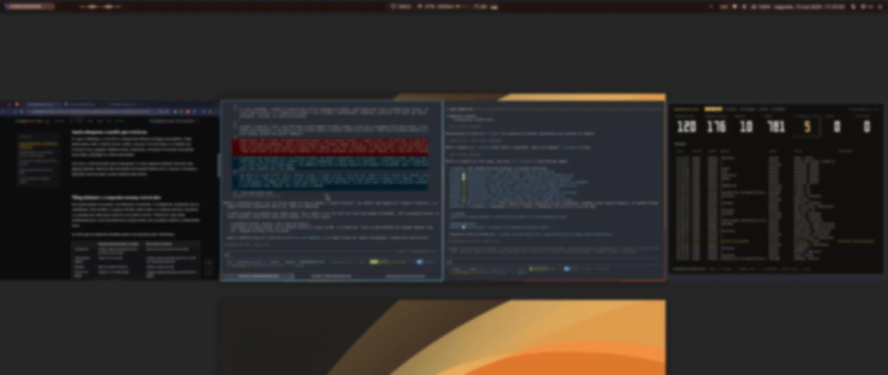
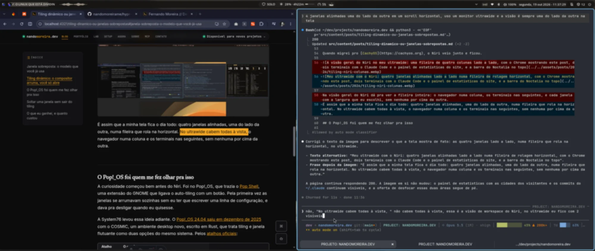

Levei uns meses pra parar de apertar `Alt+Tab`. Era vício de anos de Windows e de macOS: a mão ia sozinha pro atalho, eu ficava ciclando janela atrás de janela procurando o terminal, e só depois lembrava que no [Niri](https://github.com/YaLTeR/niri) o terminal estava duas colunas à esquerda, a um atalho de distância.

O vício era tanto que, quando ainda usava o [Hyprland](https://hypr.land), eu tentei trazer o `Alt+Tab` junto em vez de largar: escrevi o [hypr-switcher](https://github.com/nandomoreirame/hypr-switcher), um Alt+Tab visual em Rust que mostra todas as janelas abertas, de todos os workspaces, num painel por cima da tela. Funcionava, mas era eu adaptando o tiling ao hábito antigo, quando o certo era largar o hábito.

## Janela sobreposta: o modelo que você já usa

É o que o Windows, o macOS e a maioria das distros entregam por padrão. Cada janela abre onde o sistema achar melhor, uma por cima da outra, e o trabalho de arrumar é seu: arrastar, redimensionar, maximizar, minimizar. Pra achar uma janela escondida, `Alt+Tab` ou a barra de tarefas.

Funciona, e funciona bem pra muita gente. O custo aparece quando você tem dez janelas abertas: parte do dia vai embora arrumando janela com o mouse e ciclando o `Alt+Tab` atrás de quem sumiu embaixo das outras.

## Tiling dinâmico: o compositor arruma, você só abre

Num gerenciador de janelas com tiling (ou compositor, no Wayland), as janelas não se sobrepõem. Elas dividem o espaço da tela, lado a lado, e o sistema decide o tamanho e a posição de cada uma conforme você abre e fecha. "Dinâmico" quer dizer exatamente isso: você não desenha o layout antes, ele se ajusta sozinho a cada janela nova.

Os dois que eu testei de verdade fazem isso de jeitos bem diferentes:

| | Hyprland (layout padrão, dwindle) | Niri (colunas roláveis) |
|---|---|---|
| Janela nova | divide o espaço da janela em foco ao meio, numa árvore | entra como uma coluna nova ao lado |
| Tela cheia de janelas | cada uma fica menor | a fileira cresce pra direita, sem fim, e a tela vira uma janela sobre ela |
| Navegar | pelo foco entre os blocos | rolando a fileira pro lado |
| Flutuar uma janela | `Super+V` na config padrão | `toggle-window-floating`, que eu deixei no `Mod+V` |

O Hyprland vem por padrão no [Omarchy](https://omarchy.org), a distro do DHH que eu usei por uns meses. O layout dele, o [dwindle](https://wiki.hypr.land/0.24.0/Configuring/Dwindle-Layout), trata a tela como uma árvore binária: cada janela nova parte a janela em foco em duas, e a direção do corte depende da proporção do espaço que sobrou.

Ainda no Omarchy, instalei o Niri pra comparar. O que me ganhou foi a fileira horizontal infinita (cara, isso me encantou): cada janela abre como uma coluna, a tela mostra um pedaço da fileira e você rola pro lado. Nada fica espremido porque abriu mais uma janela; ela só entra na fila. No meu ultrawide de 34", com a coluna padrão em metade da tela e o `Mod+R` alternando entre um terço, metade e dois terços, isso é tudo o que eu preciso:

```kdl
layout {
    preset-column-widths {
        proportion 0.33333
        proportion 0.5
        proportion 0.66667
    }

    default-column-width { proportion 0.5; }
}
```

Quando migrei pro [CachyOS](https://cachyos.org), o Niri veio junto e ficou.



Na visão de workspaces do Niri dá pra ver a fileira inteira: quatro janelas alinhadas, uma do lado da outra, sem nenhuma por cima da outra. No dia a dia o ultrawide mostra duas por vez, e eu rolo a fileira pro lado pra chegar nas outras.



## O Pop!_OS foi quem me fez olhar pra isso

A curiosidade começou bem antes do Niri. Foi no Pop!_OS, que trazia o [Pop Shell](https://github.com/pop-os/shell), uma extensão do GNOME que ligava o auto-tiling com um botão. Pela primeira vez as janelas se arrumavam sozinhas sem eu ter que escrever uma linha de configuração, e dava pra desligar quando eu quisesse.

A System76 levou essa ideia adiante. O [Pop!_OS 24.04 saiu em dezembro de 2025](https://www.gamingonlinux.com/2025/12/pop-os-24-04-lts-with-the-cosmic-desktop-environment-is-out-now/page=1/) com o COSMIC, um ambiente desktop novo, escrito em Rust, que trata tiling e janela flutuante como duas opções do mesmo sistema. Pelos [atalhos oficiais](https://system76.com/support/articles/pop-cosmic-keyboard-shortcuts):

| Atalho | O que faz |
|---|---|
| `Super+Y` | liga e desliga o tiling no workspace atual |
| `Super+G` | solta ou prende uma janela (flutuante) |
| `Super+S` | empilha janelas em abas |
| `Super+O` | troca a orientação do corte, de vertical pra horizontal |

O tiling também liga por um applet no painel, e uma janela flutuante arrastada até a borda da tela se encaixa em metade ou em um quarto dela, como no Windows. Ou seja, quem vem do Windows não precisa escolher um lado no primeiro dia: começa com as janelas soltas e liga o tiling num workspace só, pra ver se gosta.

Eu ainda não testei o COSMIC. Ouvi falar muito bem dele e tô curioso, mas tudo o que está nesta seção vem da documentação, não da minha máquina.

## Soltar uma janela sem sair do tiling

A objeção mais comum de quem nunca usou tiling é "mas e quando eu quero uma janela solta, no meio da tela?". Os três deixam. No Hyprland é `Super+V`, no COSMIC é `Super+G`, e no Niri é o `toggle-window-floating`, mais o `switch-focus-between-floating-and-tiling` pra pular o foco entre as janelas soltas e as colunas.

Na prática eu quase não uso o atalho. Uso muito a janela flutuante, mas pra app de uso temporário: ele abre no meio da tela, eu faço rápido o que preciso e escondo de novo. Em vez de soltar na mão toda vez, deixo uma regra no `config.kdl` que já abre esses apps flutuando:

```kdl
window-rule {
    match app-id=r#"(?i)zapzap"#
    open-floating true
}
```

WhatsApp, Spotify, Discord, Obsidian e o YouTube Music abrem assim, e um atalho faz cada um aparecer e sumir sem ocupar uma coluna. Como o Niri não tem minimizar, montei isso com um workspace escondido, e contei o como [no post do scratchpad](/scratchpad-no-niri-janelas-que-somem-com-um-atalho).

## O que eu ganhei, e quanto custou

O custo foi o `Alt+Tab`. Os primeiros meses foram de mão indo pro atalho errado, e de reaprender a navegar por posição (a janela tá à esquerda, a janela tá no workspace 2) em vez de por lista.

O ganho é controle. Tudo o que está aberto está mapeado na minha cabeça: eu sei que o navegador está numa coluna, os terminais nas seguintes, e com dois ou três atalhos chego em qualquer janela sem procurar. Nada fica escondido embaixo de outra janela, porque não existe "embaixo".

## Conclusão

A pergunta que todo mundo faz é se tiling é melhor que janela sobreposta. Pra mim essa é a pergunta errada. Hoje eu não volto mais, mas **tiling não é melhor que janela sobreposta: é outro jeito de organizar, e quem decide é você testando**. Se você usa Linux há algum tempo, o seu ambiente veio com um desses modelos sem ninguém te perguntar nada, e vale descobrir qual combina com a sua cabeça.

Tem gente que pensa melhor com as janelas soltas e o mouse na mão, e tá tudo bem. Teste os dois modelos por algumas semanas cada um, e não por uma tarde: os meus primeiros meses de tiling foram ruins porque eu brigava com o hábito, e não com a ferramenta. O COSMIC parece o jeito mais fácil de fazer esse teste, já que você liga e desliga o tiling por workspace sem instalar nada. Depois, use o que mais te agrada.

`niri msg action quit`
