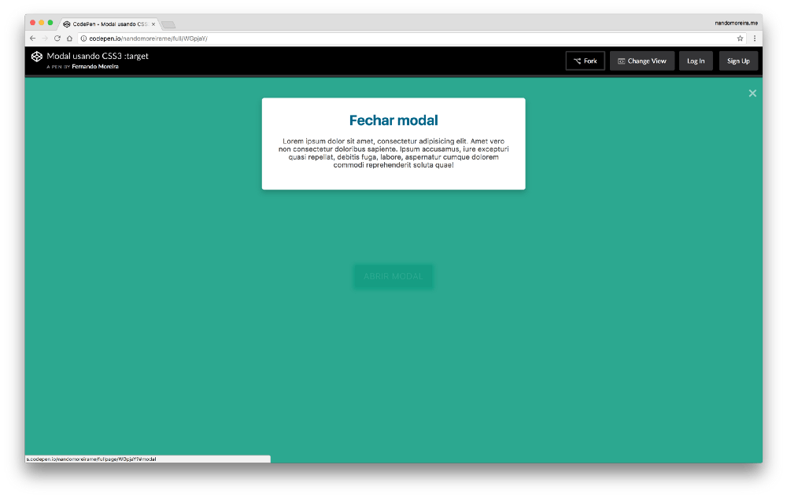

### O pseudo selector

Um pseudo selector das CSS3 muito útil é o `:target`, ele fornece recursos de estilo para um elemento cujo o ID está visivel na url.

É bem simples de entender, vamos ver uma demonstração nesse <a href="http://codepen.io/nandomoreirame/details/WGpjaY/" target="_blank">Pen</a>

https://codepen.io/oseunando/pen/WGpjaY

O pseudo selector `:target` pode ser aplicado em qualqer tag, classe ou ID em seu CSS, mais ou menos assim:

```css
/* Aplica em todos os elementos que tenha o target ativo na URL */
:target {
  color: #000;
}

/* aplica cor apenas em H2 que tenha o target ativo na URL */
h2:target {
  color: #f00;
}
```

---

### O Modal

Sendo assim, então podemos aplicar o `display: block` em nosso modal, certo? Isso mesmo.

```css
#modal:target {
  display: block;
}
```

O resto vc já sabe né, estilize o quanto quiser e de preferência anime-o para ficar mais bonito.

---

É isso, peço desculpas se o artigo não foi grande coisa pra você, eu não posso fazer nada se as CSS são simples demais. 😌

Divirta-se!

`</end>`
